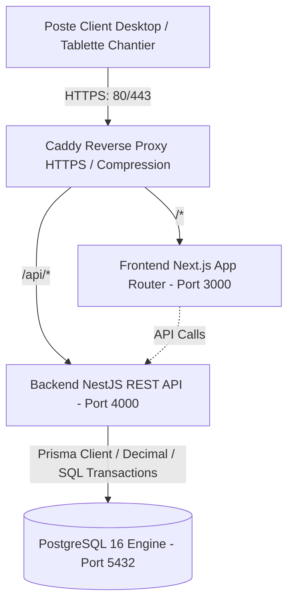

# ARCHITECTURE TECHNIQUE & LOGICIELLE — SILEX INDUSTRIAL ERP

> **Produit** : SILEX Industrial ERP (Plateforme de Gestion des Opérations et Projets Industriels)  
> **Cible** : Entreprise de services et travaux industriels (Algérie)  
> **Stack** : Monorepo pnpm | Next.js 15 (App Router) | NestJS 11 | PostgreSQL 16 | Prisma ORM | Docker & Caddy

---

## 1. Vue d'Ensemble & Principes Directeurs

SILEX ERP est conçu pour répondre aux exigences d'un environnement industriel exigeant (Oil & Gas, Sidérurgie, Cimenterie, Énergie) :
1. **Zéro approximation financière** : Utilisation exclusive du type `Decimal` (PostgreSQL `NUMERIC(15,2)`) pour tous les flux d'engagements, achats, situations de travaux et dépenses.
2. **Immuabilité des mouvements physiques** : Aucun stock n'est modifié par écrasement direct. Chaque variation provient d'un mouvement d'inventaire tracé et audité.
3. **Ségrégation stricte des rôles (SoD)** : Les vérifications d'habilitation sont exécutées au niveau de l'API NestJS par des Guards et des Interceptors indépendamment du frontend.
4. **Cohérence transactionnelle** : Toute opération multi-ressources (ex: Réception de commande impactant stock, bon de commande et imputation projet) s'exécute dans une transaction atomique PostgreSQL (`prisma.$transaction`).



---

## 2. Structure du Monorepo

```
SILEX/
├── apps/
│   ├── web/                    # Next.js 15 App Router, Tailwind CSS, shadcn/ui, Recharts
│   └── api/                    # NestJS 11 API modulaire, Prisma ORM, Swagger, JWT
├── packages/
│   ├── shared/                 # Enums, constantes régionales, types partagés, utils
│   ├── contracts/              # Interfaces d'échange API (DTOs, requêtes, réponses)
│   └── validation/             # Schémas Zod partagés entre frontend et backend
├── infrastructure/
│   ├── docker/                 # Dockerfiles multi-stage & docker-compose.yml
│   ├── caddy/                  # Configuration du reverse-proxy Caddy (Caddyfile)
│   └── scripts/                # Scripts de backup, restore, migration et seed
└── docs/                       # Documentation exhaustive du système
```

---

## 3. Architecture Backend (NestJS)

L'API NestJS est découpée en modules métier hautement cohésifs :

```
apps/api/src/
├── common/
│   ├── decorators/             # @CurrentUser(), @Roles(), @RequirePermission()
│   ├── filters/                # GlobalHttpExceptionFilter, PrismaExceptionFilter
│   ├── guards/                 # JwtAuthGuard, RolesGuard, ProjectAccessGuard
│   ├── interceptors/           # AuditLogInterceptor, TransformResponseInterceptor
│   └── prisma/                 # PrismaService, PrismaModule
├── modules/
│   ├── auth/                   # Connexion, rafraîchissement JWT, switch profil démo
│   ├── users/                  # Utilisateurs, rôles, départements, permissions
│   ├── projects/               # Projets, jalons, tâches, budgets, ODS, attachements, situations
│   ├── procurement/            # Demandes d'achat (DA), offres fournisseurs, comparateur, bons de commande (BC)
│   ├── inventory/              # Articles, magasins, réceptions, sorties chantiers, transferts, ledger
│   ├── finance/                # Engagements, dépenses, factures clients/fournisseurs, dashboard rentabilité
│   ├── hr/                     # Employés, contrats, qualifications/habilitations, présences
│   ├── fleet/                  # Engins, machines, véhicules, maintenance préventive/corrective
│   ├── quality/                # GED, gestion des non-conformités, audits, actions correctives
│   ├── workflows/              # Moteur d'approbation et boîte de réception des validations
│   ├── reports/                # Services d'agrégation et génération de rapports / exports
│   └── audit/                  # Traçabilité immuable des événements et décisions
└── main.ts                     # Configuration Swagger, CORS, ValidationPipe, Helmet
```

---

## 4. Architecture Frontend (Next.js App Router)

L'interface adopte une approche **desktop-first** adaptée aux bureaux d'études et directions de chantiers, avec une adaptabilité réactive :

```
apps/web/src/
├── app/
│   ├── (auth)/
│   │   └── login/              # Page de connexion professionnelle
│   ├── (dashboard)/
│   │   ├── layout.tsx          # Sidebar persistante, barre supérieure, sélecteur de démo
│   │   ├── page.tsx            # Redirection vers le dashboard DG
│   │   ├── dashboard/          # Dashboard exécutif DG avec filtres et graphiques
│   │   ├── projects/           # Liste des projets & Fiche projet 15 onglets
│   │   ├── procurement/        # DA, comparateur fournisseurs, bons de commande
│   │   ├── inventory/          # Stocks, magasins, réceptions, sorties chantier
│   │   ├── hr/                 # Personnel, habilitations, présences, démo paie
│   │   ├── finance/            # Pilotage financier et rentabilité par projet
│   │   ├── maintenance/        # Parc matériel et ordres de travail
│   │   ├── quality/            # GED documentaire et non-conformités
│   │   ├── workflows/          # Boîte de réception des approbations
│   │   ├── reports/            # Rapports consolidés et exports
│   │   └── admin/              # Administration des utilisateurs et audit log
├── components/
│   ├── ui/                     # Boutons, badges, modales, tables, inputs (Inter, Navy/Teal)
│   ├── layout/                 # Sidebar, Header, Breadcrumbs, DemoRoleSwitcher
│   └── shared/                 # DataTables TanStack, Graphiques Recharts, StatusBadges
├── hooks/                      # useAuth, usePermissions, useProjects, useProcurement
├── lib/                        # Client Axios/Fetch typé, gestion des tokens, formatters DA
└── styles/                     # Tailwind CSS, variables de la palette SILEX
```

---

## 5. Modèle de Données & Intégrité Transactionnelle

Le schéma Prisma structure les relations fondamentales de l'entreprise industrielle :
- **Clés primaires** : CUIDs ordonnancés pour performance et robustesse.
- **Audits automatiques** : Déclenchement d'un enregistrement `AuditLog` pour chaque modification de statut ou action financière/physique.
- **Isolation des projets** : Table de liaison `UserProjectAssignment` garantissant qu'un chef de projet ne visualise que les chantiers dont il est responsable.
