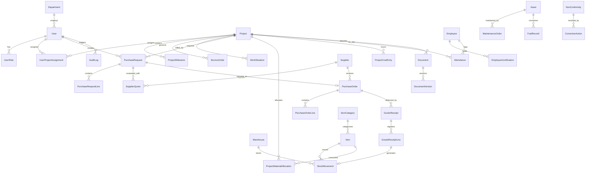

# MODÈLE DE DONNÉES & SCHÉMA RELATIONNEL (ERD) — SILEX INDUSTRIAL ERP

> **Moteur** : PostgreSQL 16  
> **ORM** : Prisma  
> **Conventions** : CUIDs, Timestamps, Types `Decimal` pour la finance, Enums stricts

---

## 1. Diagramme Entité-Relation (ERD)

---

## 2. Dictionnaire des Données Clés & Types Décimaux

### 2.1 Entités Financières & Quantités (Prisma Decimal)
Pour garantir l'exactitude financière et éliminer tout risque d'arrondi binaire :
- `Project.contractAmount` : `Decimal(15, 2)` (DA)
- `Project.budgetAmount` : `Decimal(15, 2)` (DA)
- `Project.committedCost` : `Decimal(15, 2)` (DA)
- `Project.actualCost` : `Decimal(15, 2)` (DA)
- `PurchaseRequestLine.estimatedUnitPrice` : `Decimal(15, 2)` (DA)
- `PurchaseRequestLine.quantity` : `Decimal(12, 2)`
- `SupplierQuoteLine.unitPrice` : `Decimal(15, 2)` (DA)
- `PurchaseOrder.totalAmountHT` : `Decimal(15, 2)` (DA)
- `PurchaseOrder.totalAmountTTC` : `Decimal(15, 2)` (DA)
- `GoodsReceiptLine.quantityReceived` : `Decimal(12, 2)`
- `StockMovement.quantity` : `Decimal(12, 2)`
- `StockMovement.unitCost` : `Decimal(15, 2)` (DA)
- `WorkSituation.amountHT` : `Decimal(15, 2)` (DA)

---

## 3. Schéma Prisma Exhaustif

Le fichier officiel du schéma est hébergé sous [apps/api/prisma/schema.prisma](file:///c:/Users/ZBOOK/Desktop/SILEX/apps/api/prisma/schema.prisma).
Il comprend l'ensemble des index pour les filtres fréquents :
- Index sur `PurchaseRequest(projectId, status)`
- Index sur `StockMovement(warehouseId, itemId, movementType)`
- Index sur `AuditLog(entityName, entityId, createdAt)`
- Index sur `Project(code, status)`
