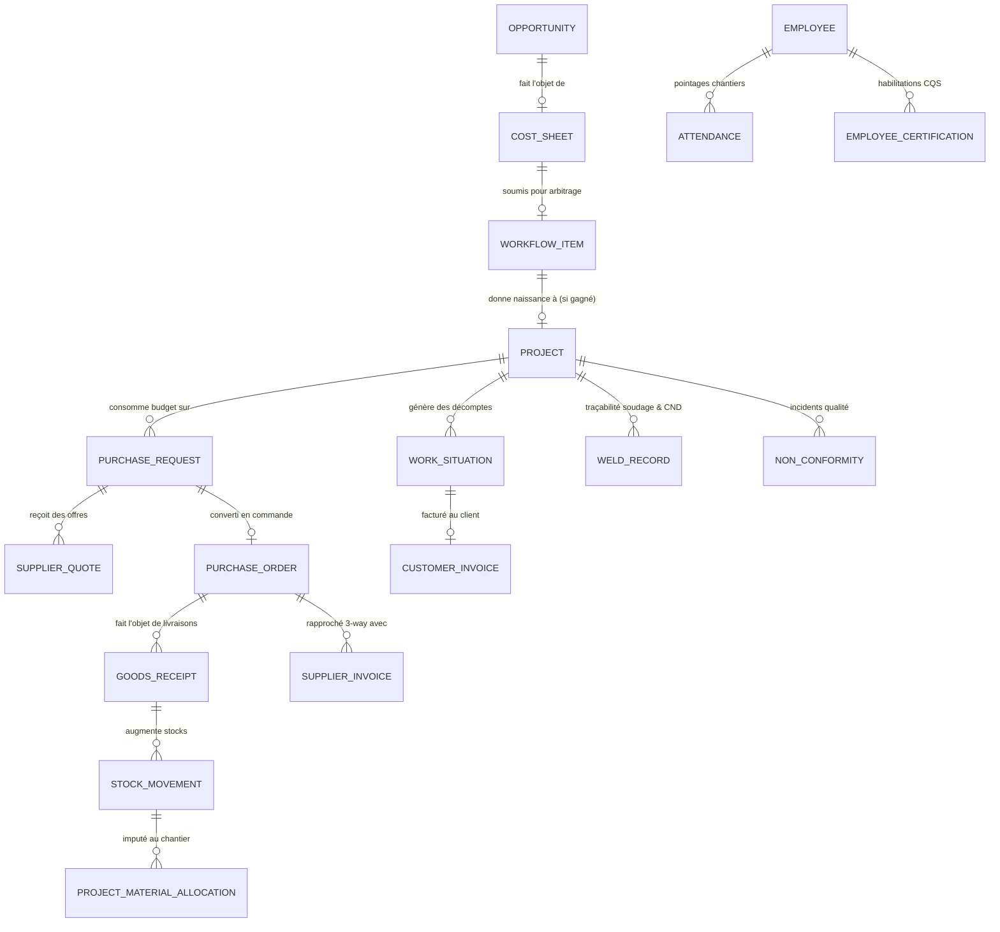

# SILEX SERVICES ERP — MODÈLE DE DONNÉES INDUSTRIEL & RÈGLES DE PERSISTANCE
**Date** : 15 Novembre 2026  
**Version** : 1.0.0 — Enterprise-Grade Industrial Data Model  
**SGBD Cible** : PostgreSQL 16 Alpine (`silex_postgres` / Neon Cloud)  
**ORM** : Prisma Client 6.4.1  
**Précision Monétaire** : Types `Decimal(15, 2)` sous PostgreSQL pour tous les montants financiers (DZD)

---

## 1. CARTOGRAPHIE RELATIONNELLE GLOBALE (INTERMODULES)

---

## 2. MODÈLE ENTITÉS-RELATIONS DÉTAILLÉ

### 2.1. Domaine Commercial & Chiffrage Collaboratif
- **`Opportunity`** :
  - `id` (UUID/CUID)
  - `code` (`OPP-YYYY-NNN`, unique)
  - `title` (String)
  - `clientName` (String, client contractuel)
  - `sector` (`IndustrialSector` enum : `OIL_AND_GAS`, `ENERGIE`, `AGROALIMENTAIRE`, `SIDERURGIE`, `CIMENTERIE`, `AUTRE_INDUSTRIE`)
  - `siteLocation` (String)
  - `wilaya` (String)
  - `estimatedAmount` (`Decimal(15, 2)`)
  - `winProbability` (Int, 0 à 100)
  - `weightedValue` (`Decimal(15, 2)`, calculée : $Montant \times Probabilite$)
  - `submissionDeadline` (DateTime)
  - `status` (`OpportunityStatus` : `NOUVELLE`, `QUALIFIEE`, `VISITE_TECHNIQUE`, `CHIFFRAGE`, `VALIDATION_INTERNE`, `OFFRE_SOUMISE`, `NEGOCIATION`, `GAGNEE`, `PERDUE`, `ANNULEE`)
  - `isDemo` (Boolean, default `false`)
  - `source` (String : `APPEL_OFFRES`, `GRE_A_GRE`, `CONSULTATION_CLIENT`)

- **`CostSheet`** :
  - `id` (UUID/CUID)
  - `reference` (`FC-YYYY-NNN`, unique)
  - `opportunityId` (Relation vers `Opportunity`)
  - `version` (Int, incrémenté à chaque révision)
  - `status` (`CostSheetStatus` : `BROUILLON`, `EN_CHIFFRAGE`, `PRETE_POUR_VALIDATION`, `VALIDEE_DG`, `REJETEE_DG`, `REVISION_DEMANDEE`)
  - `projectContribution` (JSON / Relation : Métrés, durées, moyens techniques, livrables, contraintes de site)
  - `procurementContribution` (JSON / Relation : Lignes d'achats chiffrées, fournitures, sous-traitance, location d'engins, délais d'approvisionnement)
  - `hrContribution` (JSON / Relation : Profils requis, effectifs, jours de mobilisation, taux journaliers, frais de mission et hébergement)
  - `financeContribution` (JSON / Relation : BFR estimé, trésorerie requise, acomptes, conditions de paiement, taux de marge cible)
  - `totalDirectCost` (`Decimal(15, 2)`, somme stricte des débours réels sans doublons)
  - `totalIndirectCost` (`Decimal(15, 2)`, frais généraux et indirects calculés par formule validée)
  - `totalEstimatedCost` (`Decimal(15, 2)` $= \text{Direct} + \text{Indirect}$)
  - `proposedSellingPrice` (`Decimal(15, 2)`, prix de vente HT proposé au client)
  - `estimatedMarginValue` (`Decimal(15, 2)` $= \text{Prix Vente HT} - \text{Coût Total}$)
  - `marginRateOnCost` (`Decimal(5, 2)` en %)
  - `markupRate` (`Decimal(5, 2)` en %, taux de marque)
  - `dgDecision` (`WorkflowDecision` : `PENDING`, `APPROVED`, `REJECTED`, `REVISION_REQUESTED`)
  - `dgDecisionNotes` (Text)
  - `dgDecidedAt` (DateTime)
  - `dgDecidedBy` (String)

---

### 2.2. Domaine Projets Industriels & Chantiers
- **`Project`** :
  - `id` (UUID)
  - `code` (`PRJ-YYYY-NNN`, unique)
  - `name` (String, nom officiel du chantier)
  - `clientName` (String, maître d'ouvrage contractuel)
  - `siteLocation` (String, désignation physique du site ou usine)
  - `wilaya` (String, code et nom wilaya d'Algérie)
  - `sector` (`IndustrialSector`)
  - `pole` (String : `Tuyauterie & Chaudronnerie`, `HVAC`, `Électricité`, `Maintenance`, `Instrumentation`)
  - `managerId` (Relation vers `User`)
  - `contractAmount` (`Decimal(15, 2)`, montant contractuel ferme HT)
  - `tvaRate` (`Decimal(4, 2)`, par défaut 19.00 %)
  - `contractAmountTTC` (`Decimal(15, 2)`)
  - `initialBudget` (`Decimal(15, 2)`)
  - `revisedBudget` (`Decimal(15, 2)`)
  - `committedCost` (`Decimal(15, 2)`, bons de commande émis et validés)
  - `actualCost` (`Decimal(15, 2)`, dépenses comptabilisées et réceptions)
  - `forecastAtCompletion` (`Decimal(15, 2)`, EAC prévisionnel final)
  - `physicalProgress` (`Decimal(5, 2)`, avancement physique contradictoire en %)
  - `financialProgress` (`Decimal(5, 2)`, avancement financier facturé en %)
  - `status` (`ProjectStatus` : `PLANNING`, `IN_PROGRESS`, `ON_HOLD`, `COMPLETED`, `CANCELLED`)
  - `riskLevel` (`ProjectRiskLevel` : `LOW`, `MEDIUM`, `HIGH`, `CRITICAL`)
  - `isDemo` (Boolean, default `false`)
  - `dataSource` (Enum : `PERSISTED`, `DEMO`, `IMPORTED`, `CALCULATED`)

---

### 2.3. Domaine QHSE — Cahier de Soudage (Weld Book) & GED
- **`WeldRecord`** (Nouveau Modèle Métier Obligatoire) :
  - `id` (UUID)
  - `projectId` (Relation vers `Project`)
  - `jointNumber` (String, identifiant unique du joint soudé, ex: `J-05-VAP-HP`)
  - `lineIso` (String, numéro de ligne tuyauterie et plan isométrique)
  - `spoolNumber` (String, repère tronçon/spool)
  - `material` (String, nuance acier, ex: `ASTM A312 TP316L`, `A106 Gr B`)
  - `heatNumber` (String, numéro de coulée avec certificat CCPU 3.1)
  - `welderId` (Relation optionnelle vers `Employee`)
  - `welderName` (String)
  - `welderStamp` (String, poinçon officiel du soudeur)
  - `welderQualification` (String, référence homologation ASME IX / ISO 9606)
  - `qualificationExpiryDate` (DateTime, contrôle d'aptitude)
  - `process` (String, ex: `141 TIG`, `111 SMAW`, `TIG+SMAW`)
  - `consumableLot` (String, lot métal d'apport et flux/gaz)
  - `dmosRef` (String, référence du Descriptif de Mode Opératoire de Soudage)
  - `cndType` (Enum : `VISUEL_VT`, `RESSUAGE_PT`, `RADIO_RT`, `ULTRASONS_UT`, `RT_ET_PT`)
  - `cndReportNumber` (String, numéro du PV contradictoire)
  - `inspectionAgency` (String, ex: `Bureau Veritas Algérie`, `TÜV`, `CTD`)
  - `status` (`WeldStatus` : `EN_ATTENTE_CND`, `CONFORME`, `REPARE_CONFORME`, `REJETE`)
  - `weldedAt` (DateTime)
  - `inspectedAt` (DateTime)
  - `isDemo` (Boolean, default `false`)

- **`Document`** (Évolution GED & Cycle de Vie) :
  - `id` (UUID)
  - `docNumber` (String, code de classement GED unique)
  - `title` (String)
  - `category` (`DocumentCategory` : `CONTRAT`, `PLAN`, `PROCEDURE_SOUDAGE`, `PV_RECEPTION`, `CERTIFICAT_MATIERE`, `QUALITE_HSE`)
  - `projectId` (Relation optionnelle vers `Project`)
  - `currentVersion` (String, ex: `1.0`, `Rev A`)
  - `revisionNumber` (Int, default 1)
  - `status` (`DocumentStatus` : `BROUILLON`, `EN_REVUE`, `APPROUVE`, `EN_VIGUEUR`, `OBSOLETE`, `ARCHIVE`)
  - `filePath` (String, chemin de stockage sécurisé du fichier binaire)
  - `fileSize` (Int)
  - `mimeType` (String)
  - `author` (String)
  - `approvedBy` (String)
  - `approvedAt` (DateTime)
  - `supersedesDocId` (UUID optionnel, référence au document obsolète remplacé)

---

## 3. RÈGLES DE PERSISTANCE, D'INTÉGRITÉ ET SOURCES DE VÉRITÉ

### 3.1. Source Unique de Vérité
1. **La base de données PostgreSQL est l'unique source de vérité persistante.**
2. Le `serverStore` en mémoire n'est qu'une couche de transition et de basculement de résilience locale. Aucun enregistrement validé par la Direction Générale ne doit demeurer uniquement en mémoire.
3. Les fiches de chiffrage commercial, les opportunités, les projets, les demandes d'achat et les enregistrements du Weld Book doivent être écrits de manière atomique via Prisma `$transaction`.

### 3.2. Règles de Suppression et d'Immutabilité
- **Interdiction stricte des suppressions physiques (`DELETE`)** sur les entités suivantes dès lors qu'elles sont engagées :
  - `Project` ayant des bons de commande émis ou des situations validées.
  - `PurchaseOrder` et `PurchaseOrderLine`.
  - `WorkSituation` validée ou facturée.
  - `CostSheet` approuvée par la Direction Générale (conservation pour traçabilité contractuelle).
  - `WeldRecord` contrôlé par CND (obligation d'historique de réparation sans écrasement de la trace d'origine).
- **Audit Trail Immuable (`AuditLog`)** :
  Toute action de création, modification de statut, approbation, rejet ou révision génère un enregistrement `AuditLog` lié à l'utilisateur de session authentifié, avec horodatage certifié au fuseau `Africa/Algiers`.

### 3.3. Règles Financières et Analytiques
1. **Interdiction de duplication des calculs financiers** :
   Le frontend React n'effectue aucun calcul métier définitif. Tous les totaux, marges, taux de marque et montants TTC sont calculés et validés par le backend NestJS / Prisma avec la bibliothèque `Decimal.js` pour éliminer tout risque d'erreur d'arrondi sur virgule flottante.
2. **Respect strict du périmètre de la Phase 6C.2.1 / 6C.4** :
   - Le moteur de rapprochement 3-Way et la détection d'écarts de prix et de quantité sont préservés.
   - Les comptes bancaires et caisses demeurent en **consultation stricte de solde**. Aucun ordre de virement, paiement bancaire réel ou décaissement automatisé n'est introduit dans le périmètre de cette mission.
