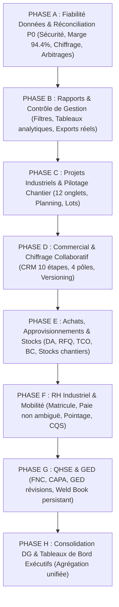

# SILEX SERVICES ERP — FEUILLE DE ROUTE D'IMPLÉMENTATION & GOUVERNANCE PAR SOUS-PHASES
**Date** : 15 Novembre 2026  
**Version** : 1.0.0 — Enterprise-Grade Implementation Roadmap  
**Méthodologie** : Développement incrémental en 8 sous-phases (Phase A à Phase H), avec validation stricte et tests avant chaque jalon  
**Environnement de validation** : PostgreSQL 16 Alpine (`silex_postgres` port 5433), Node.js, Next.js 15.5, NestJS 11

---

## 1. SYNTHÈSE DES SOUS-PHASES & PLANNING STRATÉGIQUE

---

## 2. DÉTAIL DES SOUS-PHASES D'EXÉCUTION

### PHASE A — Fiabilité des Données, Réconciliation P0 & Sécurité
- **Objectifs prioritaires** :
  1. **Sécurité RBAC / SoD** : Désactiver impérativement le contournement de rôle `/api/auth/demo-switch` en dehors de l'environnement de développement explicite. Supprimer tous les messages incitant à basculer côté client.
  2. **Correction de la Marge Globale 94,4 %** : Remplacer la formule erronée par le calcul exact de rentabilité (EAC, Coûts réels, Chiffre d'affaires contractuel, ou affichage « Données insuffisantes »).
  3. **Réconciliation du Chiffrage Commercial (`FC-2026-001`)** : Éliminer la superposition des lignes Projet avec les débours Achats et RH. Réconcilier la contribution à 26 090 000 DA directs + 3 130 800 DA indirects = 29 220 800 DA.
  4. **Synchronisation Arbitrages DG** : Aligner la boîte de réception `/workflows` et le tableau de bord exécutif `/dashboard` pour qu'ils interrogent la même source de vérité et affichent les fiches de coût au même titre que les DA et les décomptes.
  5. **Pipeline Commercial** : Supprimer les fallbacks statiques (`74 500 000 DA`), normaliser les statuts du CRM et recalculer le pipeline pondéré de manière dynamique.
  6. **Tag Démo / Production** : Marquer explicitement chaque entité (`isDemo: true/false`, source `PERSISTED` vs `DEMO`) et nettoyer les dénominations arbitraires.
- **Livrables de sortie** :
  - Code corrigé dans `serverStore`, `dbBridge`, `auth-context`, `reports`, `dashboard`, `workflows`, `commercial`.
  - Script de test E2E P0 de vérification unitaire et d'intégrité financière.

---

### PHASE B — Rapports Consolidés & Contrôle de Gestion
- **Objectifs** :
  1. Filtres transversaux réactifs : Période (début/fin), Exercice comptable, Client, Projet, Secteur industriel, Pôle métier, Chef de projet, Statut chantier, Wilaya, Devise, Filtre strict Démo/Réel.
  2. Indicateurs budgétaires certifiés : CA Contractuel HT/TTC, Budget initial vs révisé, Engagements BC, Dépenses réelles, EAC, Solde budgétaire, Marge prévisionnelle vs Marge réalisée.
  3. Tableau analytique des chantiers avec colonnes bien alignées (distinction stricte entre Maître d'ouvrage et Site/Wilaya d'exécution).
  4. Exports réels opérationnels :
     - CSV UTF-8 avec BOM et séparateur point-virgule compatible Excel.
     - Export Excel structuré avec formatage monétaire DZD et métadonnées.
     - Export PDF A4 imprimable avec charte graphique SILEX, cartouche et mentions de conformité fondées sur un audit réel.
- **Critères d'acceptation** : Les exports reflètent exactement les données filtrées à l'écran sans troncature.

---

### PHASE C — Projets Industriels & Pilotage de Chantier
- **Objectifs** :
  1. Fiche projet complète à 12 onglets unifiés : Vue générale, Données contractuelles (TVA, retenue de garantie 5%, pénalités), Planning jalons/tâches, Budget & Rentabilité par lots (MO, matières, location, sous-traitance, frais indirects), Achats & Commandes, Stocks consommés, Ressources humaines, Pointages, Qualité & Sécurité, Documents GED, Situations de travaux, Historique & Audit.
  2. Découplage strict entre Avancement Physique (%) et Consommation Budgétaire (%).
  3. Association dynamique des Ordres de Service (ODS de démarrage, arrêt, reprise, modificatif).

---

### PHASE D — Commercial, Pipeline CRM & Chiffrage Collaboratif
- **Objectifs** :
  1. CRM industriel à 10 statuts normalisés avec probabilité de gain et valeur pondérée.
  2. Fiche de chiffrage collaboratif multi-services :
     - Projet : Métrés, durées, contraintes site.
     - Achats : Fournitures, cotations matières, délais fournisseurs, matériels loués.
     - RH : Effectifs, jours, taux journaliers, frais de vie.
     - Finance : BFR, cashflow, acomptes, risques de paiement.
  3. Calculs financiers stricts en backend (`Decimal`) : Prix de revient, Marge brute, Taux de marque, Marge sur coût.
  4. Gestion des versions et conversion automatique en Projet/Contrat dès attribution.

---

### PHASE E — Achats, Approvisionnements & Gestion des Stocks
- **Objectifs** :
  1. Cycle complet d'achat : Demande d'Achat (DA) avec contrôle budgétaire préalable et consultation de stock disponible -> RFQ -> TCO -> Arbitrage -> Bon de Commande (BC) -> Réception magasin (BR) -> Rapprochement 3-way -> Facture fournisseur.
  2. Traçabilité des états de stocks : Disponible, Réservé projet, En commande, Réceptionné, Consommé sur chantier, Retourné.
  3. Imputation analytique précise des Bons de Sortie (BS) au code chantier destinataire pour interdire toute double comptabilisation.

---

### PHASE F — Ressources Humaines Industrielles & Mobilité
- **Objectifs** :
  1. Fiche collaborateur enrichie : Matricule unique, contrat, pôle technique, habilitations.
  2. Rémunération explicite sans ambiguïté : Définition claire de la périodicité (mensuelle contractuelle vs taux journalier de débours chantier).
  3. Pointage et feuilles de présence chantier avec workflow de validation hiérarchique.
  4. Circuit des congés : Demande -> Visa Conducteur de travaux -> Contrôle RH -> Décision Direction Générale.
  5. Suivi des qualifications techniques de soudage (ASME IX, ISO 9606) avec date de validité et alertes d'expiration.

---

### PHASE G — Qualité, QHSE & Bibliothèque Documentaire GED
- **Objectifs** :
  1. Modélisation et persistance intégrale du **Weld Book** (Cahier de Soudage) : Numéro de joint, ligne isométrique, spool, coulée, nuance acier, soudeur, poinçon, DMOS, contrôles CND (RT/PT/UT), rapport de contrôle et traçabilité des réparations.
  2. Fiches de Non-Conformité (FNC) et workflow CAPA complet (Confinement -> Analyse cause racine -> Action corrective -> Clôture).
  3. Bibliothèque GED avec gestion des versions (Rev A, Rev 0, Rev 1), cycle d'approbation et métadonnées réelles.

---

### PHASE H — Consolidation Direction Générale & Tableaux de Bord
- **Objectifs** :
  1. Tableau de bord DG unifié agrégeant les indicateurs certifiés de tous les modules (Portefeuille chantiers, Marges réelles, Pipeline pondéré, Trésorerie disponible, Dettes et Créances échues, Dossiers critiques en attente d'arbitrage).
  2. Source unique de données garantissant une stricte symétrie entre les Rapports, le Tableau DG, les Projets et les Workflows.
  3. Audit trail complet et non modifiable des décisions stratégiques de l'entreprise.

---

## 3. GOUVERNANCE, MATRICE DE RISQUES & CRITÈRES D'ACCEPTATION

| Risque Identifié | Impact Potentiel | Stratégie d'Atténuation Obligatoire |
| :--- | :--- | :--- |
| **Altération de la base Neon de production** | **Catastrophique** | Interdiction formelle de migration ou d'écriture de test sur Neon. Utilisation exclusive du conteneur local PostgreSQL 16 (`silex_postgres`). |
| **Régression sur les règles Finance existantes** | **Critique** | Préservation intégrale du périmètre 6C.2.1 / 6C.4. Zéro nouvelle écriture de décaissement ou paiement bancaire réel. |
| **Divergence calculatoire Frontend / Backend** | **Élevé** | Centralisation de tous les calculs de rentabilité et marges sur le backend avec `Decimal.js`. |
| **Affichage d'indicateurs erronés par manque de données** | **Moyen** | Affichage explicite de mentions « Non calculable » ou « Données insuffisantes » au lieu de pourcentages fantaisistes. |
