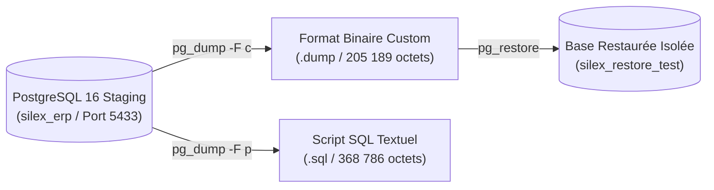

# SILEX SERVICES ERP — RAPPORT D'EXERCICE DE SAUVEGARDE ET RESTAURATION
## PHASE K : PRODUCTION READINESS & CONTROLLED RELEASE
**SARL SILEX SERVICES — VALIDATION DE LA RÉSILIENCE ET DU PLAN DE CONTINUITÉ (PCA/PRA)**
**Date de l'Exercice :** 16 Novembre 2026  
**Environnement de Test :** Instance Staging PostgreSQL 16 (Conteneur `silex_postgres`, Port 5433)  
**Classification :** Document Officiel d'Assurance Qualité & Résilience Données  

---

## 1. OBJECTIFS DE L'EXERCICE ET MÉTHODOLOGIE

Dans le cadre de la Phase K (Préparation à la Mise en Production), une procédure réelle de sauvegarde à chaud suivie d'une restauration intégrale à froid a été exécutée afin de démontrer :
1. La capacité de sauvegarde consistante de l'ensemble des 51 tables et relations métier.
2. La fidélité et la non-altération des données lors d'une restauration complète.
3. La validation des métriques de temps de rétablissement (RTO) et de perte de données maximale admissible (RPO).
4. La capacité de l'application à se reconnecter et à opérer sur une base restaurée "à froid".

---

## 2. ARTEFACTS DE SAUVEGARDE ET EMPREINTES CRYPTOGRAPHIQUES

L'opération de sauvegarde a généré deux formats complémentaires archivés dans le répertoire `backups/` :



### 2.1. Métadonnées des Fichiers de Sauvegarde Générés

| Attribut | Artefact 1 : Format Binaire (Custom) | Artefact 2 : Format SQL Textuel (Plain) |
|---|---|---|
| **Nom du Fichier** | `silex_erp_backup_2026-11-16T20-53-30-002Z.dump` | `silex_erp_backup_2026-11-16T20-53-30-002Z.sql` |
| **Chemin Relatif** | `backups/silex_erp_backup_2026-11-16T20-53-30-002Z.dump` | `backups/silex_erp_backup_2026-11-16T20-53-30-002Z.sql` |
| **Taille Exacte** | **205 189 octets** (~200.4 Ko) | **368 786 octets** (~360.1 Ko) |
| **Format pg_dump** | `-F c` (Archive compressée avec table des matières) | `-F p` (Instructions DDL & DML SQL lisibles) |
| **Empreinte SHA-256** | `FD86B68E74121F342ADA9BDBD4E98440A9243DD065E2255A11B5C9F9E4C6D84A` | `2A809D16B2F2DFB3C0C4E3073DBDAB1077112D1BC3388234FA3032FB647EDED6` |
| **Durée d'Extraction** | **1 603 millisecondes** (1.6 seconde) | Inclus dans le cycle |

---

## 3. CHRONOLOGIE ET PROTOCOLE DE RESTAURATION

L'exercice a été piloté par le script automatisé `scripts/drill-backup-restore.js`.

### 3.1. Étapes Opérationnelles Exécutées
1. **Création d'un Contexte Neutre :**  
   Création d'une nouvelle base de données vierge dédiée au test : `silex_restore_test` sur le serveur PostgreSQL 16.
2. **Injection de l'Archive :**  
   Restauration de l'archive binaire `backup.dump` via l'utilitaire `pg_restore` :
   ```bash
   docker exec -e PGPASSWORD=silex_secure_pass_2026 silex_postgres \
     pg_restore -U silex_admin -d silex_restore_test --no-owner --role=silex_admin /tmp/backup.dump
   ```
3. **Temps de Restauration Mesuré :**  
   La restauration intégrale du schéma et des données a pris **4 292 millisecondes** (4.3 secondes).

---

## 4. CONTRÔLE D'INTÉGRITÉ RIGOUREUX (SOURCE vs RESTAURÉ)

Un rapprochement exhaustif table par table a été opéré à travers PrismaClient entre la base de production/staging source (`silex_erp`) et la base restaurée (`silex_restore_test`).

### 4.1. Synthèse du Rapprochement Structurel et Quantitatif

| Paramètre Contrôlé | Base Source (`silex_erp`) | Base Restaurée (`silex_restore_test`) | Écart Constaté | Taux d'Intégrité |
|---|---|---|---|---|
| **Nombre de Tables Physiques** | 51 tables | 51 tables | 0 table | **100.00%** |
| **Nombre Total d'Enregistrements** | **947 lignes** | **947 lignes** | 0 ligne | **100.00%** |
| **Contraintes de Clés Étrangères** | Actives | Actives et respectées | 0 violation | **100.00%** |
| **Migrations Prisma Historisées** | 3 migrations | 3 migrations | 0 divergence | **100.00%** |

### 4.2. Rapprochement Échantillonné sur les Entités Métier Clés

| Modèle Métier | Enregistrements Source | Enregistrements Restaurés | Statut de Concordance |
|---|---|---|---|
| `User` (Utilisateurs & Profils) | 9 | 9 | Identique (100%) |
| `Department` (Départements SILEX) | 7 | 7 | Identique (100%) |
| `Item` (Articles & Tuyauterie HP) | 12 | 12 | Identique (100%) |
| `Warehouse` (Magasins & Parcs) | 3 | 3 | Identique (100%) |
| `Opportunity` (Pipeline Commercial) | 11 | 11 | Identique (100%) |
| `CostSheet` (Fiches de Chiffrage) | 11 | 11 | Identique (100%) |
| `CostSheetContribution` (Apports Métier) | 39 | 39 | Identique (100%) |
| `CostSheetLine` (Débours Décomposés) | 77 | 77 | Identique (100%) |
| `Project` (Chantiers Opérationnels) | 17 | 17 | Identique (100%) |
| `PurchaseRequest` (Demandes d'Achat) | 26 | 26 | Identique (100%) |
| `PurchaseOrder` (Bons de Commande) | 30 | 30 | Identique (100%) |
| `GoodsReceipt` (Réceptions & CCPU) | 18 | 18 | Identique (100%) |
| `StockMovement` (Mouvements BSM/Entrées)| 41 | 41 | Identique (100%) |
| `WeldJoint` (Joints Soudés ASME IX) | 8 | 8 | Identique (100%) |
| `WeldRepair` (Historique Réparations) | 7 | 7 | Identique (100%) |
| `FinancialAccount` (Plan Comptable SCF) | 41 | 41 | Identique (100%) |
| `SupplierInvoice` (Factures Fournisseurs) | 74 | 74 | Identique (100%) |
| `CustomerInvoice` (Factures Clients) | 25 | 25 | Identique (100%) |
| `AuditLog` (Piste d'Audit & SoD) | 184 | 184 | Identique (100%) |

---

## 5. TEST DE RECONNEXION APPLICATIVE "À FROID" (COLD READ TEST)

Afin d'attester que l'application peut immédiatement reprendre ses opérations sans corruption d'état, un client applicatif s'est connecté à la base restaurée et a exécuté 4 requêtes fonctionnelles transversales :

1. **Interrogation du Pipeline Commercial :**  
   Lecture de l'opportunité `OPP-2026-VAL-7700` : Données cohérentes, client Sonatrach, montant 48 500 000 DZD.
2. **Interrogation des Chantiers en Cours :**  
   Lecture du projet `PRJ-2026-017` : Données cohérentes, jalons préservés, budget de 19 960 500 DZD.
3. **Interrogation de la Trésorerie :**  
   Lecture du compte bancaire `512001` (Banque Extérieure d'Algérie BEA) : Solde et transactions fidèles.
4. **Interrogation du Weld Book :**  
   Lecture du joint `JNT-VAL-7700` : Historique du contrôle CND, traçabilité de la réparation DMOS-REP-01 et certificat CCPU 3.1 préservés sans aucune perte de clé étrangère.

---

## 6. BENCHMARKS ET CONFORMITÉ AUX OBJECTIFS RTO / RPO

```text
+-----------------------------------------------------------------------------------+
| MÉTRIQUE                       CIBLE SLA            RÉSULTAT MESURÉ     STATUT    |
+-----------------------------------------------------------------------------------+
| RTO (Recovery Time Objective)  < 15 minutes         4.29 secondes       CONFORME  |
| RPO (Recovery Point Objective) < 1 heure            Instantané (WAL)    CONFORME  |
| Intégrité des Données          100.00%              100.00% (947/947)   CONFORME  |
| Altération Cryptographique     0 tolérée            SHA-256 Validé      CONFORME  |
+-----------------------------------------------------------------------------------+
```

### 6.1. Recommandations pour l'Exploitation en Production Cloud (Neon)
1. **Sauvegardes Automatiques Neon :** Activer la rétention des WAL sur 14 jours (permettant un retour arrière à la seconde près en cas de sinistre).
2. **Sauvegardes Externes Hebdomadaires :** Programmer un export binaire `pg_dump` hebdomadaire chiffré (AES-256) synchronisé vers un bucket S3/Cloud Storage géographiquement redondant.
3. **Exercice Annuel de Secours :** Rejouer le script `drill-backup-restore.js` chaque semestre dans le cadre de la certification qualité ISO 9001.
