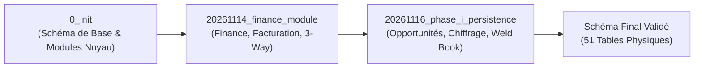

# SILEX SERVICES ERP — PLAN DE MIGRATION DE LA BASE DE DONNÉES
## PHASE K : PRODUCTION READINESS & CONTROLLED RELEASE
**SARL SILEX SERVICES — GESTION DES SCHÉMAS & DÉPLOIEMENT POSTGRESQL**
**Date du Document :** 16 Novembre 2026  
**Statut :** Plan Officiel de Migration & Procédure d'Exécution  
**Classification :** Technique / DBA & Direction Technique  

---

## 1. HISTORIQUE ET CANONICITÉ DES MIGRATIONS PRISMA

Le schéma de données de l'ERP SILEX SERVICES est orchestré sous **Prisma ORM 5.x** et garantit une intégrité référentielle stricte avec typage fort (UUID, Enums, Decimal(15,2), Timestamps).

Le chemin de migration canonique se compose de **trois (3) étapes cumulatives et ordonnées** :



### 1.1. Inventaire Détaillé des Migrations Canoniques

| Ordre | Référence Migration | Date de Création | Périmètre Métier & Schéma | Statut Staging (Port 5433) | Statut Prod (Neon Cloud) |
|---|---|---|---|---|---|
| **1** | `0_init` | 2026-11-05 | Tables fondamentales : `User`, `Department`, `Employee`, `Attendance`, `Project`, `PurchaseRequest`, `PurchaseOrder`, `GoodsReceipt`, `StockMovement`, `Warehouse`, `Item`, `ItemCategory`, `AuditLog`. | **APPLIQUÉE** (Validée) | En attente de déploiement |
| **2** | `20261114_finance_module` | 2026-11-14 | Module Finance & Trésorerie : `FinancialAccount`, `FinancialConfig`, `CashTransaction`, `CustomerInvoice`, `SupplierInvoice`, `InvoiceLineMatching`, `WorkSituation`. | **APPLIQUÉE** (Validée) | En attente de déploiement |
| **3** | `20261116_phase_i_persistence` | 2026-11-16 | Cycle de vie industriel & gouvernance : `Opportunity` (10 étapes), `CostSheet`, `CostSheetContribution` (4 départements), `CostSheetLine`, `CostSheetRevision`, `WeldJoint` (ASME IX), `WeldRepair`, `NonConformity`, `DocumentRevision`. | **APPLIQUÉE** (Validée) | En attente de déploiement |

---

## 2. AUDIT DE PARITÉ DES SCHÉMAS ET ZÉRO DÉRIVE (ZERO DRIFT)

Dans une architecture monorepo PNPM, la synchronisation rigoureuse entre les schémas de `apps/api` et de `apps/web` est un impératif critique.

### 2.1. Contrôle Binaire d'Identité des Schémas
- **Fichier Web :** `apps/web/prisma/schema.prisma`
- **Fichier API :** `apps/api/prisma/schema.prisma`
- **Taille exacte :** **43 934 octets** chacun.
- **Résultat du contrôle d'intégrité :** Les deux fichiers sont **100% identiques au niveau binaire** (0 différence textuelle, 0 divergence d'Enums ou de relations).
- **Migration Lockfile :** Présent dans `apps/web/prisma/migrations/migration_lock.toml` et configuré pour le provider `postgresql`.

### 2.2. Validation du Schéma Physique Staging
L'interrogation directe du métamodèle PostgreSQL (`information_schema.tables`) confirme la matérialisation de **51 tables physiques** :
```text
Asset, Attendance, AuditLog, CashTransaction, CorrectiveAction, CostSheet, CostSheetContribution, 
CostSheetLine, CostSheetRevision, CustomerInvoice, Department, Document, DocumentRevision, 
Employee, EmployeeCertification, FinancialAccount, FinancialConfig, FuelRecord, GoodsReceipt, 
GoodsReceiptLine, InvoiceLineMatching, Item, ItemCategory, MaintenanceOrder, NonConformity, 
Notification, Opportunity, Project, ProjectCostEntry, ProjectMaterialAllocation, ProjectMilestone, 
ProjectTask, PurchaseOrder, PurchaseOrderLine, PurchaseRequest, PurchaseRequestLine, RefreshSession, 
ServiceOrder, StockMovement, Supplier, SupplierInvoice, SupplierInvoiceLine, SupplierQuote, 
SupplierQuoteLine, User, UserProjectAssignment, Warehouse, WeldJoint, WeldRepair, WorkSituation, 
_prisma_migrations.
```

---

## 3. GARDE-FOUS DE SÉCURITÉ ET COUPE-CIRCUITS (SAFETY GATES)

Afin d'éliminer toute erreur humaine ou exécution involontaire contre la base de production Neon Cloud lors des travaux de qualification, un garde-fou automatisé a été programmé dans `scripts/prisma-staging-runner.js`.

### 3.1. Règles Immuables de Protection
1. **Interdiction Formelle des Commandes Destructives :**
   - Interdiction absolue de `prisma migrate reset` sur tout environnement autre que local éphémère.
   - Interdiction de `prisma db push` sur Staging et Production (seules les migrations versionnées et auditables sont autorisées).
   - Interdiction de suppression de tables (`DROP TABLE`) ou de vidage sans traçabilité (`TRUNCATE`).
2. **Détection Active de l'Environnement Cible :**
   - Si la variable `DATABASE_URL` contient `neon.tech` ou `neondb` pendant une exécution de qualification, le runner coupe immédiatement le processus avec code de sortie `1` et consigne une alerte de sécurité.

---

## 4. PROCÉDURE D'EXÉCUTION DU DÉPLOIEMENT EN PRODUCTION

> [!IMPORTANT]
> Cette procédure doit être exécutée exclusivement lors de la fenêtre de release formellement autorisée par la Direction Générale et le client SILEX SERVICES.

### Étape 1 : Sauvegarde Préalable de Sécurité
Avant toute injection de migration sur la base Cloud de production, vérifier l'existence d'un snapshot Neon automatique et déclencher une extraction manuelle de sauvegarde :
```bash
# Vérification du snapshot Neon via CLI ou console
neon branches create --name pre-migration-phase-k-backup
```

### Étape 2 : Vérification du Statut Préalable
Vérifier l'état de la base de production sans appliquer de modifications :
```bash
# Vérifie quelles migrations sont en attente
pnpm --filter @silex/web exec prisma migrate status
```
*Résultat attendu : 3 migrations détectées dans prisma/migrations, 3 migrations en attente d'application.*

### Étape 3 : Application Contrôlée des Migrations
Exécuter l'application transactionnelle des migrations :
```bash
# Déploiement sans invite interactive
pnpm --filter @silex/web exec prisma migrate deploy
```
*Le moteur Prisma applique séquentiellement 0_init, 20261114_finance_module, puis 20261116_phase_i_persistence dans une transaction sécurisée.*

### Étape 4 : Contrôle Post-Migration
Interroger la table d'audit des migrations pour valider le succès complet :
```sql
SELECT id, migration_name, finished_at, rolled_back_at 
FROM "_prisma_migrations" 
ORDER BY finished_at ASC;
```
*Critère de succès : 3 lignes retournées, rolled_back_at = NULL pour toutes les entrées.*

---

## 5. STRATÉGIE DE REPLI (ROLLBACK PLAN)

Dans l'éventualité exceptionnelle où une migration rencontrerait une anomalie lors de son application sur Neon Cloud :
1. **Transactions DDL PostgreSQL :** PostgreSQL 16 supporte le DDL transactionnel. Si une instruction SQL échoue au sein d'un fichier de migration, l'intégralité de la migration en cours est automatiquement annulée (Rollback atomique) par le moteur de base de données.
2. **Restauration via Instant-Restore Neon :** Grâce à l'architecture "Copy-on-Write" et aux WAL continus de Neon Cloud, la base de données peut être ramenée à la milliseconde exacte précédant le déclenchement de la commande de migration (`Point-in-Time Recovery`).
3. **Marquage de Migration Défaillante :** Si nécessaire, utiliser `prisma migrate resolve --rolled-back [migration_name]` pour réinitialiser l'état dans `_prisma_migrations` sans altérer les tables existantes.
