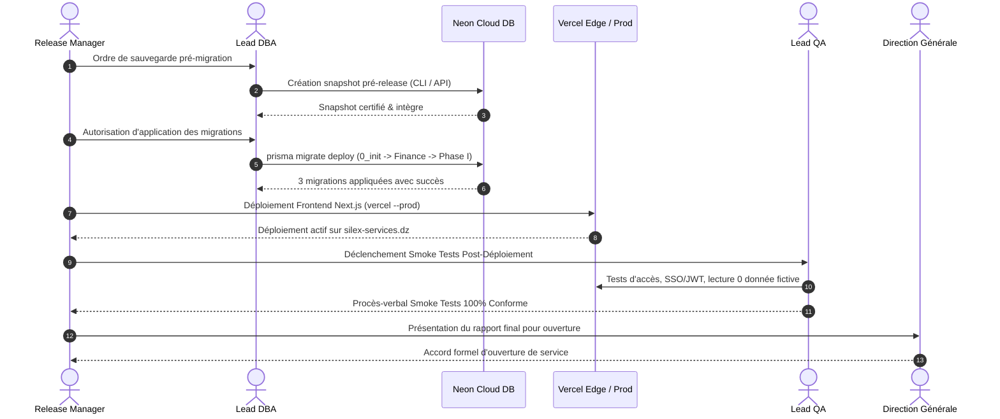

# SILEX SERVICES ERP — CAHIER DE DÉPLOIEMENT EN PRODUCTION (RELEASE RUNBOOK)
## PHASE K : PRODUCTION READINESS & CONTROLLED RELEASE
**SARL SILEX SERVICES — PROCÉDURE OPÉRATIONNELLE DE MISE EN PRODUCTION**
**Date du Document :** 16 Novembre 2026  
**Version de Référence :** Release v1.0.0-PROD  
**Classification :** Procédure Opérationnelle Critique (Runbook)  

---

## 1. OBJECTIF ET RÔLES OPÉRATIONNELS

Ce document définit le protocole standardisé et irréversible à suivre lors de la fenêtre de bascule en production de l'ERP SILEX SERVICES.

### 1.1. Matrice des Responsabilités de Release

| Rôle Opérationnel | Titulaire Désigné | Responsabilités Principales |
|---|---|---|
| **Release Manager** | Lead Architecte SILEX | Pilotage chronologique, coordination technique, déclenchement du Go/No-Go |
| **Lead DBA** | Ingénieur Base de Données | Sauvegardes Neon, exécution des migrations Prisma, validation des index |
| **Lead QA** | Responsable Recette | Exécution des smoke tests post-déploiement, validation de non-régression |
| **Sponsor Exécutif** | Direction Générale SARL SILEX | Autorisation formelle d'ouverture des accès utilisateurs |

---

## 2. CHECKLIST PRÉALABLE AU DÉPLOIEMENT (T-24H À T-1H)

Avant toute intervention sur l'infrastructure de production, l'ensemble des prérequis suivants doit être validé :

```text
[ ] 1. Code Freeze acté sur la branche de release (master / release-v1.0.0).
[ ] 2. Intégrité Git certifiée : working tree propre, commit HEAD identifié et tagué.
[ ] 3. Compilation TypeScript sans erreur (pnpm --filter @silex/web exec tsc --noEmit && pnpm --filter @silex/api exec tsc --noEmit -> Exit 0).
[ ] 4. Suites de tests E2E 100% vertes en staging (8 suites + cycle 16 étapes -> Exit 0).
[ ] 5. Variables d'environnement de production injectées et validées dans Vercel et Neon.
[ ] 6. Clés de signature JWT_SECRET et REFRESH_TOKEN_SECRET régénérées avec une entropie forte (256 bits).
[ ] 7. Snapshot de sécurité préventif créé sur le projet Neon Production.
[ ] 8. Fenêtre de maintenance planifiée et notifiée aux utilisateurs clés.
```

---

## 3. PROTOCOLE D'EXÉCUTION DU DÉPLOIEMENT (T-0)



### Étape 3.1 : Création du Point de Restauration Pré-Migration
Sur l'interface de gestion Neon ou via la CLI Neon, créer un snapshot immuable :
```bash
# Snapshot Neon préalable
neon branches create --project-id ep-solitary-sun-be7s53de --name pre-release-v1-snapshot
```

### Étape 3.2 : Exécution de la Migration de Schéma Prisma
Exécuter l'application des migrations depuis une console d'administration sécurisée connectée à `DIRECT_URL` :
```bash
# Vérification de l'état
pnpm --filter @silex/web exec prisma migrate status

# Application des migrations transactionnelles
pnpm --filter @silex/web exec prisma migrate deploy
```
*Vérification post-migration :*
```sql
SELECT migration_name, finished_at FROM "_prisma_migrations" ORDER BY finished_at ASC;
```
Attendu : 3 lignes (`0_init`, `20261114_finance_module`, `20261116_phase_i_persistence`).

### Étape 3.3 : Déploiement Applicatif Frontend (Vercel)
Déployer la version compilée et auditée :
```bash
# Déploiement en production
vercel --prod --token=$VERCEL_TOKEN
```
Vérifier l'assignation du domaine officiel : `https://silex-services.dz`.

---

## 4. PROTOCOLE DE SMOKE TESTS POST-DÉPLOIEMENT

Immédiatement après le déploiement, l'équipe QA exécute le protocole de vérification à chaud :

| Test N° | Point de Contrôle | Procédure Opérationnelle | Résultat Attendu | Statut |
|---|---|---|---|---|
| **ST-01** | Disponibilité HTTPS | Requête `GET https://silex-services.dz` | Code HTTP 200, certificat SSL valide | En attente |
| **ST-02** | Healthcheck API | Requête `GET /api/health` | Code HTTP 200, `{"status":"ok","db":"connected"}` | En attente |
| **ST-03** | Authentification DG | Connexion avec identifiants officiels DG | Génération du jeton JWT, redirection Dashboard | En attente |
| **ST-04** | Étancheité Données | Contrôle de la table des opportunités | 0 donnée de test ou mock présente | En attente |
| **ST-05** | Affichage Dashboard | Chargement des KPI financiers et chantiers | Données réelles ou état vide professionnel | En attente |
| **ST-06** | Intégrité des Exports | Génération d'un export Excel test | Fichier `.xlsx` valide téléchargé sans erreur | En attente |

---

## 5. STRATÉGIE DE REPLI D'URGENCE (ROLLBACK RUNBOOK)

En cas d'anomalie bloquante détectée lors des smoke tests (échec de connexion DB, corruption de schéma, instabilité critique) :

### 5.1. Critère de Décision de Repli
La décision de rollback est prononcée conjointement par le Release Manager et le Sponsor Exécutif si un incident bloquant n'est pas résolu dans un délai de **15 minutes**.

### 5.2. Procédure de Repli Frontend (Instant Rollback Vercel)
Vercel conserve l'ensemble des builds précédents. Le retour arrière est instantané :
```bash
# Rétablissement du déploiement précédent
vercel rollback [DEPLOYMENT_ID_PRÉCÉDENT] --token=$VERCEL_TOKEN
```
*Délai de bascule DNS/Edge :* **< 30 secondes**.

### 5.3. Procédure de Repli Base de Données (Neon Point-in-Time Recovery)
Grâce à la technologie "Copy-on-Write" de Neon, le rétablissement de la base de données est immédiat :
```bash
# Restauration de la branche principale depuis le snapshot pré-release
neon branches reset-to-commit main --commit [COMMIT_ID_PRE_RELEASE]
```
*Délai de rétablissement de la base :* **< 60 secondes**.

---

## 6. PHASE D'HYPERCARE (SUPPORT RENFORCÉ J+1 À J+7)

1. **Surveillance Continue des Logs :** Surveillance des taux d'erreurs HTTP 5xx et des temps de réponse via Vercel Analytics et logs système.
2. **Monitoring du Pool de Connexions :** Surveillance du nombre de connexions actives sur PgBouncer (maintien sous le seuil d'alerte de 80%).
3. **Point Quotidien DG / Chantiers :** Réunion quotidienne de 15 minutes à 08h30 pour traiter immédiatement tout retour utilisateur des équipes terrain.
