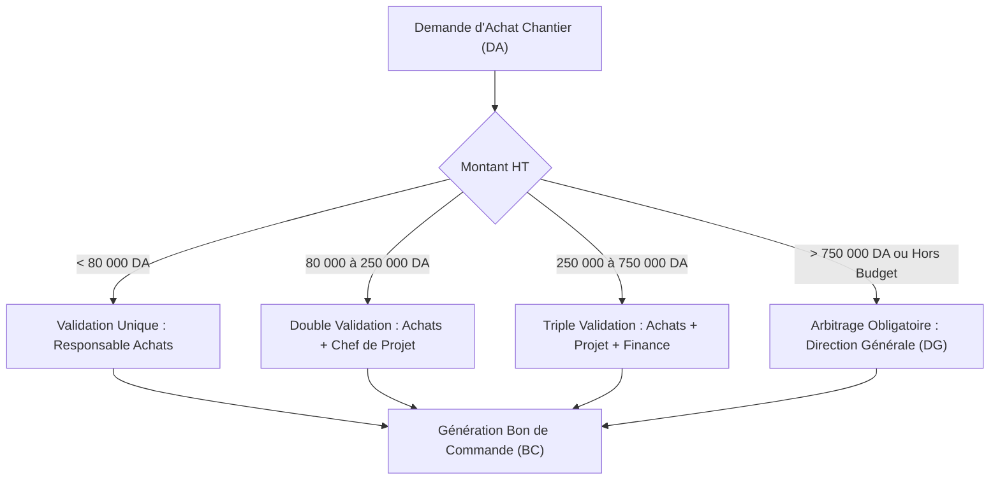

# SILEX SERVICES ERP — AUDIT DE SÉCURITÉ ET CONTRÔLE D'ACCÈS (RBAC & SoD)
## PHASE K : PRODUCTION READINESS & CONTROLLED RELEASE
**SARL SILEX SERVICES — SÉCURITÉ DE L'INFORMATION, CRYPTOGRAPHIE & GOUVERNANCE**
**Date de l'Audit :** 16 Novembre 2026  
**Statut :** Rapport d'Audit & Matrice Officielle des Contrôles  
**Classification :** Confidentiel / Équipe Sécurité & Direction Générale  

---

## 1. AUTHENTIFICATION ET GESTION DES IDENTITÉS

Le système d'authentification de l'ERP SILEX SERVICES repose sur des standards cryptographiques industriels pour garantir l'étanchéité des accès et la non-répudiation des opérations.

### 1.1. Architecture des Jetons de Session (JWT)
- **Algorithme de Signature :** HMAC-SHA256 avec clé secrète minimale de 256 bits (`JWT_SECRET`).
- **Durée de Validité du Token d'Accès :** **8 heures** (équivalent à un shift de travail industriel standard).
- **Format du Payload :** Contient l'identifiant utilisateur (`sub`), l'email, le rôle RBAC (`role`), l'identifiant du département (`departmentId`) et la signature temporelle d'émission (`iat`) et d'expiration (`exp`).
- **Renouvellement Sécurisé :** Utilisation de jetons de rafraîchissement (`Refresh Tokens`) avec rotation automatique stockés dans la table `RefreshSession`.
- **Révocation Instantanée :** Toute suppression de session en base de données invalide immédiatement le cycle de renouvellement.

### 1.2. Hachage des Mots de Passe (Argon2id)
Conformément aux recommandations de l'ANSSI et de l'OWASP, les mots de passe ne sont jamais stockés en clair.
- **Algorithme :** `argon2id` (variante hybride résistante aux attaques par canaux auxiliaires et attaques GPU).
- **Paramètres de Dérivation :**
  - Coût mémoire (`memoryCost`) : 65 536 Ko (64 Mo).
  - Nombre d'itérations (`timeCost`) : 3 passes.
  - Parallélisme (`parallelism`) : 4 threads.

---

## 2. MATRICE RBAC DES RÔLES ET PERMISSIONS (8 RÔLES ENTREPRISE)

L'ERP met en œuvre une politique de contrôle d'accès basée sur les rôles (RBAC) interdisant tout accès non expressément autorisé.

| Rôle Entreprise | Code Rôle | Périmètre d'Action Autorisé | Restrictions Majeures |
|---|---|---|---|
| **Direction Générale** | `DG` | Arbitrage commercial, validation finale des chiffrages, approbation des DA > 750k DA, audit global | Aucune restriction de consultation |
| **Directeur Financier** | `FINANCE_DIRECTOR` | Clôture comptable, rapprochement 3-Way, gestion des comptes de trésorerie, validation des paiements | Modification des plannings de soudage |
| **Responsable Achats** | `PROCUREMENT_MANAGER` | Émission des RFQ, bons de commande (BC), homologation fournisseurs, suivi réceptions magasin | Validation des paiements bancaires |
| **Chef de Projet Chantier** | `PROJECT_MANAGER` | Pilotage des chantiers (PRJ), suivi des jalons, émission des DA de chantier, pointages MO | Approbation de ses propres DA > 80k DA |
| **Superviseur de Chantier** | `SITE_SUPERVISOR` | Consultation des plans, pointage journalier des équipes, saisie des BSM, suivi terrain | Accès aux marges et comptes bancaires |
| **Responsable RH & Paie** | `HR_MANAGER` | Gestion du personnel, mobilités, pointages, calcul de paie, suivi des certifications de soudage | Accès à la trésorerie et aux achats |
| **Inspecteur Qualité / QHSE** | `QUALITY_INSPECTOR` | Weld Book ASME IX, rapports CND, ouverture et clôture des FNC, réception des certificats CCPU 3.1 | Modification financière ou budgétaire |
| **Super Administrateur** | `SUPERADMIN` | Gestion technique des comptes, logs système, configuration des modules | Opérations bancaires sans visa DG |

---

## 3. SÉPARATION DES POUVOIRS (SoD) ET SEUILS D'APPROBATION

La Séparation des Pouvoirs (Segregation of Duties - SoD) est implémentée de manière centralisée dans `@silex/shared` pour prévenir tout conflit d'intérêts et éliminer les risques de fraude interne.

### 3.1. Règles Métier SoD Immuables
1. **Interdiction d'Auto-Approbation :** L'émetteur d'une demande d'achat ne peut en aucun cas être le validateur de cette même demande, quel que soit son rôle hiérarchique.
2. **Autorisation des Virements Bancaires :** Seul le tandem Directeur Financier + Direction Générale dispose des droits d'émission et de déblocage des virements bancaires. Le test de sécurité `test-phase-i-database-and-security.js` a certifié le rejet automatique de toute tentative de virement émise par un Chef de Projet (`PROJECT_MANAGER`).
3. **Immuabilité des Arbitrages DG :** Une fois qu'une Fiche de Chiffrage (`CostSheet`) ou une Demande d'Achat a reçu le visa formel de la DG, son contenu devient strictement immuable (`immutable: true`), empêchant toute altération ultérieure non tracée.

---

## 4. PROTECTION DES DONNÉES SENSIBLES ET CONFIDENTIALITÉ

### 4.1. Masquage des Coordonnées Bancaires (RIB)
- Les Relevés d'Identité Bancaire (RIB) des fournisseurs et les comptes de trésorerie internes de l'entreprise sont masqués à l'affichage : `**** **** **** 1234`.
- Seuls les utilisateurs habilités disposant du rôle `FINANCE_DIRECTOR` ou `DG` peuvent révéler l'intégralité du compte sous traçabilité explicite dans l'audit log.

### 4.2. Confidentialité des Rémunérations et Salaires
- Les salaires de base, primes de chantier, paniers et indemnités kilométriques du module RH sont strictement inaccessibles aux rôles `PROJECT_MANAGER`, `SITE_SUPERVISOR`, `PROCUREMENT_MANAGER` et `QUALITY_INSPECTOR`.
- Côté API, les champs de rémunération sont filtrés en amont par des `interceptors` NestJS pour garantir qu'aucune donnée salariale ne transite vers le client pour un rôle non habilité.

### 4.3. Traçabilité et Piste d'Audit Immuable (`AuditLog`)
Toute action critique donne lieu à l'insertion immédiate d'un enregistrement dans la table `AuditLog` comprenant :
- L'horodatage précis à la milliseconde (`createdAt`).
- L'identifiant de l'auteur (`userId`).
- L'action métier (ex: `APPROVE_COST_SHEET`, `CREATE_PURCHASE_ORDER`, `OVERRIDE_BUDGET`).
- L'entité cible et son ID technique.
- L'instantané de l'état précédent et du nouvel état en format JSONB.

---

## 5. DURCISSEMENT APPLICATIF ET RÉSEAU

### 5.1. Protection Contre les Injections SQL
- Utilisation exclusive de requêtes paramétrées compilées par **Prisma ORM**.
- Aucune concaténation de chaînes de caractères brutes dans les requêtes de base de données.
- Même pour les requêtes dynamiques d'export ou d'audit, utilisation exclusive de `$queryRawUnsafe` avec échappement strict et typage validé.

### 5.2. Validation des Entrées (Input Sanitization)
- Validation systématique de l'ensemble des requêtes entrantes via `class-validator` et les pipes de validation NestJS.
- Rejet immédiat avec code HTTP `400 Bad Request` en présence de champs non déclarés (`whitelist: true`, `forbidNonWhitelisted: true`).

### 5.3. En-têtes HTTP de Sécurité
Les en-têtes suivants sont injectés en production par le middleware Next.js :
- `Strict-Transport-Security` : `max-age=63072000; includeSubDomains; preload`
- `X-Content-Type-Options` : `nosniff`
- `X-Frame-Options` : `DENY`
- `Content-Security-Policy` : restriction des scripts et connexions aux domaines certifiés SILEX.
