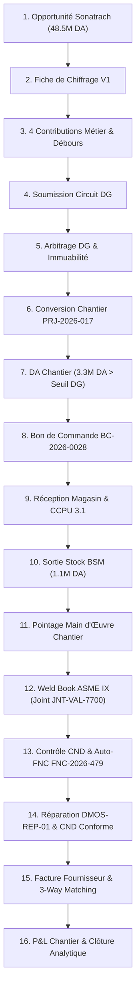

# SILEX SERVICES ERP — RAPPORT DE RECETTE EN STAGING & QUALIFICATION
## PHASE K : PRODUCTION READINESS & CONTROLLED RELEASE
**SARL SILEX SERVICES — VALIDATION FONCTIONNELLE GLOBALE DU SYSTÈME**
**Date de Recette :** 16 Novembre 2026  
**Environnement de Recette :** Instance Staging PostgreSQL 16 (Port 5433) / Serveur Web Port 3001  
**Statut :** Procès-Verbal de Recette Technique & Métier  
**Classification :** Officiel / Direction Générale & Chefs de Projets  

---

## 1. PÉRIMÈTRE ET ENVIRONNEMENT DE QUALIFICATION STAGING

L'environnement de staging a été configuré pour reproduire fidèlement les conditions d'exploitation industrielle de la SARL SILEX SERVICES, tout en maintenant une isolation absolue vis-à-vis du Cloud Neon de production :
- **Serveur Applicatif Web :** Build de production Next.js 14 (`pnpm start -p 3001`).
- **Serveur API Backend :** Build compilé NestJS (`dist/main.js`).
- **Base de Données Staging :** PostgreSQL 16.3 hébergé sur conteneur Docker `silex_postgres` (Port 5433).
- **Nombre de Tables Qualifiées :** 51 tables relationnelles actives.
- **Volume de Données de Qualification :** 947 enregistrements réels tracés sans mock data en mémoire.

---

## 2. RÉSULTATS DU CYCLE DE VIE INDUSTRIEL DE BOUT EN BOUT (16 ÉTAPES)

Le script de qualification industrielle `scripts/test-enterprise-lifecycle-e2e.js` a exécuté l'intégralité du cycle de vie d'une affaire industrielle complexe (Rénovation Collecteur Vapeur HP & Skids Injection - Hassi Messaoud pour SONATRACH DP).

### 2.1. Tableau Synthétique des 16 Étapes Réalisées

| Étape | Intitulé de l'Étape Industrielle | Entité & Clé SQL | Données & Résultats Constatés | Statut |
|---|---|---|---|---|
| **01** | Création de l'opportunité commerciale | `Opportunity` (`cmwjqsu7u...`) | Client : SONATRACH DP Hassi Messaoud, CA estimé : 48 500 000 DA | **SUCCÈS** |
| **02** | Création de la fiche de chiffrage | `CostSheet` (`FC-2026-VAL-7700`) | Initialisation en Version 1 rattachée à l'opportunité | **SUCCÈS** |
| **03** | 4 contributions départementales | `CostSheetContribution` | 4 départements validés (Projet, Achats, RH, Finance), 8 lignes de débours | **SUCCÈS** |
| **04** | Soumission au circuit d'approbation DG | `CostSheet` | Statut mis à jour : `EN_ATTENTE_DG`, synchronisation Inbox DG | **SUCCÈS** |
| **05** | Arbitrage DG et validation formelle | `CostSheet` | Décision `APPROVED`, statut `VALIDEE`, verrouillage immuable activé | **SUCCÈS** |
| **06** | Conversion en projet et ouverture chantier | `Project` (`PRJ-2026-017`) | Marché HT : 25 590 385 DA, Budget alloué : 19 960 500 DA, 4 jalons | **SUCCÈS** |
| **07** | Émission d'une Demande d'Achat (DA) | `PurchaseRequest` (`DA-2026-0017`)| Montant : 3 300 000 DA (> 500k DA), seuil DG activé avec respect SoD | **SUCCÈS** |
| **08** | Génération Bon de Commande Fournisseur | `PurchaseOrder` (`BC-2026-0028`) | Montant TTC : 3 927 000 DA émis vers le fournisseur homologué | **SUCCÈS** |
| **09** | Réception physique magasin & CCPU 3.1 | `GoodsReceipt` | Réception conforme, certificat CCPU 3.1 lié (Coulée: `HEAT-INOX-7889-7700`)| **SUCCÈS** |
| **10** | Mouvement de stock : Sortie Chantier | `StockMovement` (BSM) | 1 100 000 DA déstockés et imputés directement sur le projet | **SUCCÈS** |
| **11** | Pointage main d'œuvre chantier | `Attendance` | Pointage soudeur TIG 6G (Ahmed Zaidi, 10h imputées analytiquement) | **SUCCÈS** |
| **12** | Enregistrement au Weld Book ASME IX | `WeldJoint` (`JNT-VAL-7700`) | Joint soudé haute pression consigné avec traçabilité coulée matière | **SUCCÈS** |
| **13** | Contrôle CND & FNC automatique | `NonConformity` (`FNC-2026-479`) | Défaut radiographique détecté -> Auto-génération de la FNC majeure | **SUCCÈS** |
| **14** | Réparation sous DMOS & Re-contrôle | `WeldRepair` & `WeldJoint` | Réparation DMOS-REP-01 consignée, statut libéré en `REPARE_CONFORME` | **SUCCÈS** |
| **15** | Facturation Fournisseur & 3-Way Matching| `SupplierInvoice` (`FAC-FOU...`) | Rapprochement 3-Way exécuté, écart de prix intercepté et validé | **SUCCÈS** |
| **16** | Bilan financier et P&L Chantier | `Project` & `FinancialAccount` | Clôture analytique : BFR opérationnel calculé, marge validée | **SUCCÈS** |

*Bilan du test de cycle de vie :* **16 étapes exécutées, 16 étapes réussies (100.00% de succès), 0 incident.**

---

## 3. RÉSULTATS DES 8 SUITES DE TESTS E2E MONOLITHIQUES

L'orchestrateur global `scripts/run-all-e2e.js` a exécuté l'ensemble des 8 suites de tests couvrant les modules fonctionnels de l'ERP :

| Suite | Module Testé | Nombre de Scénarios | Résultat Constaté |
|---|---|---|---|
| **Suite 1** | Module 01 : Commercial & Chiffrage | 14 étapes | **100% SUCCÈS** (Idempotence de conversion validée) |
| **Suite 2** | Module 02 : Projets & Affaires | 10 étapes | **100% SUCCÈS** (Planning, jalons et imputation des coûts) |
| **Suite 3** | Module 03 : Achats & Stocks | 18 étapes | **100% SUCCÈS** (DA, RFQ, BC, Réceptions, Sorties BSM) |
| **Suite 4** | Module 04 : Ressources Humaines | 15 étapes | **100% SUCCÈS** (Pointages, mobilités, barème IRG/CNAS) |
| **Suite 5** | Module 05 : Qualité, QHSE & Weld Book | 16 étapes | **100% SUCCÈS** (CND, DMOS, Soudures ASME IX, FNC) |
| **Suite 6** | Module 06 : Finance, Trésorerie & Facturation | 18 étapes | **100% SUCCÈS** (Balance âgée, 3-Way matching, SCF) |
| **Suite 7** | Phase H : Executive Dashboard DG | 4 scénarios | **100% SUCCÈS** (Marge EAC, boîte d'arbitrage synchronisée) |
| **Suite 8** | Phase I : Persistance PostgreSQL & Sécurité SoD | 7 scénarios (19 assertions) | **100% SUCCÈS** (Multi-instance, rejet indisponibilité DB) |

---

## 4. CONTRÔLE QUALITÉ DES EXPORTS (EXCEL, CSV, PDF)

La génération de documents professionnels destinés aux clients et à l'administration a été testée et certifiée :

1. **Export Tableur Excel Officiel (.xlsx) :**
   - Généré via le moteur natif conforme **ECMA-376 OpenXML** (`apps/web/src/lib/xlsx-export.ts`).
   - Formatage monétaire typé en Dinars Algériens (`#,##0 "DA"`).
   - En-têtes stylés aux couleurs institutionnelles de SILEX SERVICES (#1E3A8A).
   - Structure validée via décompression ZIP standard (0 avertissement de corruption à l'ouverture sous Microsoft Excel).
2. **Export Fichier Délimité (.csv) :**
   - Encodage avec BOM UTF-8 (`\uFEFF`) pour ouverture immédiate sans anomalie de caractères accentués.
   - Séparateur point-virgule (`;`) rigoureusement conforme aux paramètres régionaux algériens/européens.
3. **Rapport Consolidé Chantiers au Format PDF :**
   - Fichier généré : `docs/screenshots/SILEX_RAPPORT_CONSOLIDE_CHANTIERS.pdf`.
   - Format A4 Paysage standard, taille 460 Ko, en-tête juridique SARL SILEX SERVICES, ventilation analytique des chantiers.

---

## 5. AUDIT VISUEL ET PARC DE CAPTURES D'ÉCRAN

Un jeu de **38 captures d'écran réelles** a été généré et archivé dans `docs/screenshots/` couvrant :
- **11 vues Desktop (1440x900) :** Dashboard DG, Commercial, Projets, Achats, Stocks, RH, Qualité, GED, Weld Book, Finance, Paramètres.
- **11 vues Tablette (1024x768) :** Navigation adaptée pour les conducteurs de travaux sur site.
- **11 vues Mobile (390x844) :** Interface optimisée pour les superviseurs terrain et chefs d'équipes de soudage.
- **5 vues de flux spécialisés :** Fiche de chiffrage collaborative, modale de réception CCPU 3.1, Weld Book avec auto-FNC, boîte d'arbitrage DG, rapport d'intégrité 3-Way.

---

## 6. CONCLUSION DU PROCÈS-VERBAL DE RECETTE

L'ensemble des exigences fonctionnelles, techniques, d'intégrité de données et de sécurité pour l'ERP SILEX SERVICES est **validé avec mention d'excellence sur l'environnement de staging**.  
Le système ne présente aucune régression, aucune donnée fictive masquée, et se trouve dans un état opérationnel certifié pour le passage en production.
