# MODÈLE DE DONNÉES RELATIONNEL ET ARCHITECTURE — SILEX ERP
**Document de Référence — Phase 3 : Architecture BDD & Modélisation**  
**Date :** Novembre 2026  
**Client :** SARL SILEX SERVICES  
**Fichier :** `docs/SILEX_DATA_MODEL.md`

---

## 1. STRATÉGIE D'ARCHITECTURE DE DONNÉES

### Réponse à l'exigence des "Cinq bases de données" :
Le cahier des charges de SILEX Services évoque "cinq bases de données, une par module".
En tant qu'architectes logiciels seniors, nous recommandons pour ce démonstrateur ERP une **base de données relationnelle centralisée et modulaire (PostgreSQL)**, avec séparation fonctionnelle stricte par schémas ou namespaces relationnels, plutôt que 5 bases physiques distinctes et cloisonnées :

1. **Continuité opérationnelle & Évitement de la double saisie** : Une opportunité commerciale validée doit instantanément générer un projet industriel, qui lui-même engendre des demandes d'achats imputées sur le budget, mobilisant des employés RH pointés sur ce même chantier, dont les coûts alimentent le résultat financier. 5 bases physiques déconnectées exigeraient une réplication lourde par bus d'événements (Kafka/RabbitMQ) prématurée à ce stade et source d'incohérences de données pendant la démonstration.
2. **Contrôle d'accès & Ségrégation par Rôles (RBAC/ABAC)** : La confidentialité et la séparation des données (ex: protection des salaires, séparation ordonnateur/acheteur) sont garanties de manière robuste et éprouvée par les politiques de contrôle d'accès au niveau applicatif et serveur (`JwtAuthGuard`, `RolesGuard`, permissions granulaires).
3. **Traçabilité & Clôture Analytique** : Une seule transaction SQL permet de garantir l'atomicité lors de la réception d'un achat, de l'augmentation du stock et de l'engagement budgétaire.

---

## 2. DIAGRAMME RELATIONNEL GLOBAL (MERMAID ERD)

```mermaid
erDiagram
    DEPARTMENT ||--o{ USER : "emploie"
    DEPARTMENT ||--o{ EMPLOYEE : "affecte"
    USER ||--o{ PROJECT : "dirige (Chef de Projet)"
    USER ||--o{ USER_PROJECT_ASSIGNMENT : "est affecté"
    PROJECT ||--o{ USER_PROJECT_ASSIGNMENT : "mobilise"
    
    COMMERCIAL_OPPORTUNITY ||--o{ COST_SHEET : "fait l'objet de"
    COST_SHEET ||--|| PROJECT : "génère après acceptation"
    COST_SHEET ||--o{ COST_SHEET_LINE : "détaille les débours"
    COST_SHEET ||--|| CUSTOMER_QUOTE : "formalise en devis"
    
    PROJECT ||--o{ PROJECT_MILESTONE : "comporte"
    PROJECT_MILESTONE ||--o{ PROJECT_TASK : "planifie"
    PROJECT ||--o{ SERVICE_ORDER : "reçoit ODS"
    PROJECT ||--o{ WORK_SITUATION : "établit attachements"
    PROJECT ||--o{ DAILY_REPORT : "enregistre journal"
    PROJECT ||--o{ PROJECT_CONSTRAINT : "subit contraintes"
    PROJECT ||--o{ PROJECT_COST_ENTRY : "consomme budget"
    
    PROJECT ||--o{ PURCHASE_REQUEST : "exprime besoins"
    PURCHASE_REQUEST ||--o{ PURCHASE_REQUEST_LINE : "contient articles"
    PURCHASE_REQUEST ||--o{ SUPPLIER_QUOTE : "met en concurrence"
    SUPPLIER ||--o{ SUPPLIER_QUOTE : "soumet offre TCO"
    SUPPLIER ||--o{ PURCHASE_ORDER : "reçoit commande"
    PURCHASE_REQUEST ||--o{ PURCHASE_ORDER : "est converti en"
    PURCHASE_ORDER ||--o{ PURCHASE_ORDER_LINE : "détaille commande"
    PURCHASE_ORDER ||--o{ GOODS_RECEIPT : "fait l'objet de"
    
    WAREHOUSE ||--o{ GOODS_RECEIPT : "réceptionne"
    ITEM ||--o{ PURCHASE_REQUEST_LINE : "référence"
    ITEM ||--o{ PURCHASE_ORDER_LINE : "commande"
    ITEM ||--o{ STOCK_MOVEMENT : "enregistre flux"
    WAREHOUSE ||--o{ STOCK_MOVEMENT : "abrite flux"
    PROJECT ||--o{ PROJECT_MATERIAL_ALLOCATION : "consomme pièces"
    
    EMPLOYEE ||--o{ EMPLOYEE_CERTIFICATION : "détient CQS"
    EMPLOYEE ||--o{ ATTENDANCE : "est pointé sur"
    PROJECT ||--o{ ATTENDANCE : "reçoit pointage"
    EMPLOYEE ||--o{ LEAVE_REQUEST : "demande congé"
    EMPLOYEE ||--o{ MISSION_ORDER : "exécute mission"
    
    CUSTOMER_INVOICE ||--o{ PAYMENT : "est réglée par"
    SUPPLIER_INVOICE ||--o{ PAYMENT : "est payée par"
    PROJECT ||--o{ CUSTOMER_INVOICE : "facture client"
    
    USER ||--o{ AUDIT_LOG : "déclenche action"
    USER ||--o{ NOTIFICATION : "reçoit alerte"
```

---

## 3. TABLES ESSENTIELLES PAR MODULE

### A. Référentiels Communs & Sécurité
- **`User`** : Collaborateurs du siège et chefs de projets avec rôle applicatif (`SystemRole`), département (`DepartmentCode`), email unique et empreinte de mot de passe `Argon2id`.
- **`Department`** : 9 départements officiels de SILEX SERVICES.
- **`UserProjectAssignment`** : Table de jonction pour le contrôle d'accès basé sur les projets (un chef de projet ne voit que ses chantiers affectés).
- **`AuditLog`** : Grand livre universel et immuable d'audit (Action, Entité, ID entité, Auteur, Rôle, IP, Horodatage, Détails).

### B. Module 01 — Commercial
- **`CommercialOpportunity`** :
  - `id`, `code` (`OPP-2026-XXX`), `clientName`, `contactName`, `contactEmail`, `contactPhone`
  - `title`, `sector` (`IndustrialSector`), `location`, `estimatedBudget` (DA)
  - `submissionDeadline`, `status` (`DRAFT`, `IN_STUDY`, `QUOTED`, `WON`, `LOST`)
  - `assignedCommercialId`
- **`CostSheet`** (Fiche de Coût Collaborative) :
  - `id`, `reference` (`FC-2026-XXX`), `opportunityId`
  - `title`, `clientName`, `siteLocation`, `status` (`DRAFT`, `IN_PRICING`, `READY_FOR_DG`, `APPROVED_BY_DG`, `REJECTED`, `REVISION_REQUESTED`)
  - Contributions des 4 services :
    - `projectNotes`, `projectDaysEstimated`, `projectEquipmentNeeded` (Projet)
    - `procurementNotes`, `procurementCostEstimated` (Achats)
    - `hrNotes`, `hrHeadcountEstimated`, `hrLaborCostEstimated` (RH)
    - `financeNotes`, `financeCashflowNeeded`, `financeRiskRating` (Finance)
  - Consolidation :
    - `totalDirectCost` (DA), `totalIndirectCost` (DA), `targetMarginPercent`, `proposedSellingPrice` (DA)
  - Arbitrage DG :
    - `dgDecision`, `dgDecisionNotes`, `dgApprovedAt`, `dgApprovedById`
- **`CostSheetLine`** : Lignes unitaires détaillées par service (travaux, matières, main d'œuvre).
- **`CustomerQuote`** (Devis Client) : Référence devis, montant HT, TVA, TTC, validité, conditions de règlement.

### C. Module 02 — Projet (Chantiers Industriels)
- **`Project`** : Entité pivot du système (`code`, `name`, `clientName`, `sector`, `managerId`, `contractAmount`, `budgetAmount`, `committedCost`, `actualCost`, `physicalProgress`, `financialProgress`, `status`, `riskLevel`, `tvaRate`, `retentionRate`).
- **`ContractItem`** : Découpage contractuel par lots avec métrés contradictoires (`itemCode`, `designation`, `unit`, `contractQty`, `realizedQty`, `validatedQty`, `unitPriceDA`, `totalContractAmountDA`, `weightPercent`).
- **`ProjectTask`** : Tâches opérationnelles par corps d'état (`code`, `name`, `team`, `plannedStartDate`, `plannedEndDate`, `actualStartDate`, `actualEndDate`, `estimatedHours`, `actualHours`, `priority`, `status`, `progress`, `isDelayed`).
- **`ProjectMilestone`** : Jalons contractuels majeurs avec pré-configurations industrielles (CND, arrêts LOTO, épreuves hydrauliques).
- **`DailyReport` (RJC / DSR)** : Journal contradictoire quotidien (`reportNumber`, `date`, `weatherConditions`, `temperature`, `manpower`, `workDone`, `heavyEquipment`, `materialsConsumed`, `hseIncidentsCount`, `siteSupervisorName`, `validationVisa`, `status`).
- **`SituationReport` (RSP)** : Rapports périodiques d'avancement croisé (`reportNumber`, `periodStart`, `periodEnd`, `physicalStatus`, `financialStatus`, `logisticsStatus`, `hrStatus`, `risksStatus`).
- **`ProjectConstraint`** : Registre centralisé des difficultés chantier (`reference`, `type`, `severity`, `impactScheduleDays`, `impactCostDA`, `correctiveAction`, `deadline`, `status`, `resolvedDate`).
- **`HseIncident`** : Consignation des événements de sécurité et contrôles CND (`reference`, `incidentDate`, `type`, `severity`, `description`, `immediateAction`, `correctiveAction`, `status`).
- **`ServiceOrder` (ODS)** : Ordres de service contractuels (démarrage, arrêt, reprise, avenant).
- **`WorkSituation` (Attachement / Situation)** : Métrés contradictoires périodiques validés pour facturation avec retenue de garantie légale (5%).

### D. Module 03 — Achats et Stocks
- **`Supplier`** : Référentiel des sous-traitants et fournisseurs industriels avec spécialités, coordonnées et note.
- **`PurchaseRequest`** & **`PurchaseRequestLine`** : Demande d'expression de besoin rattachée au chantier.
- **`SupplierQuote`** & **`SupplierQuoteLine`** : Offres des fournisseurs en concurrence pour l'analyse TCO.
- **`PurchaseOrder`** & **`PurchaseOrderLine`** : Bons de commande officiels avec TVA légale DZ (19%, 9%, 0% ANDI).
- **`GoodsReceipt`** & **`GoodsReceiptLine`** : Réceptions contradictoires avec pointage quantitatif.
- **`Warehouse`** : Dépôts et magasins physiques (central ou chantiers).
- **`Item`** & **`ItemCategory`** : Catalogue des pièces, consommables, profilés acier et tuyaux.
- **`StockMovement`** : Grand livre des entrées/sorties/transferts avec coût unitaire moyen pondéré (CUMP).
- **`ProjectMaterialAllocation`** : Affectation des matières sorties de stock vers le compte analytique du chantier.

### E. Module 04 — Ressources Humaines
- **`Employee`** : Fiche signalétique des collaborateurs (matricule, nom, fonction, contrat CDI/CDD, département).
- **`EmployeeCertification`** : CQS, habilitations soudage / CND, licences et visites médicales avec alertes péremption.
- **`Attendance`** : Pointages quotidiens rattachés au matricule salarié et au code projet.
- **`LeaveRequest`** : Demandes de congés payés et autorisations d'absence avec circuit d'approbation.
- **`MissionOrder`** : Ordres de mission pour les déplacements en zone industrielle ou bases de vie du Sud.
- **`RecruitmentRequest`** : Demande de renfort pour besoins spécifiques d'un chantier.

### F. Module 05 — Finance et Comptabilité
- **`ProjectCostEntry`** : Journal analytique d'imputation de tous les coûts directs (Matières, Main d'œuvre, Sous-traitance, Matériel locatif).
- **`CustomerInvoice`** : Factures émises à destination des clients industriels sur la base des situations validées.
- **`SupplierInvoice`** : Factures d'achats reçues, rapprochées des bons de commande et réceptions.
- **`Payment`** : Règlements enregistrés (encaissements et décaissements) avec référence pièce comptable.

---

## 4. RÈGLES D'INTÉGRITÉ & DE SÉCURITÉ DES DONNÉES

1. **Précision Numérique** : Tous les montants financiers sont stockés sous forme de types décimaux exacts (`Decimal(15, 2)`), interdisant l'utilisation de flottants binaires pour les calculs de TVA, de facturation ou de budget.
2. **Contrainte Anti-Stock Négatif** : Une contrainte SQL de niveau base de données (`CHECK (current_stock >= 0)`) et un verrouillage transactionnel au niveau Prisma garantissent qu'aucune sortie ne peut dépasser le stock disponible.
3. **Fuseau Horaire & Dates** : Horodatage strict stocké en UTC et restitué dans le fuseau officiel de l'Algérie (`Africa/Algiers` — UTC+1).
4. **Devise par Défaut** : Dinar Algérien (DZD / DA) appliqué partout.
5. **Intégrité Référentielle** : Suppression en cascade protégée (`RESTRICT` sur les projets ayant des DA ou des écritures comptables, pour empêcher toute destruction accidentelle de l'historique financier).

---
*Fin du document — Modèle de Données SILEX ERP.*
