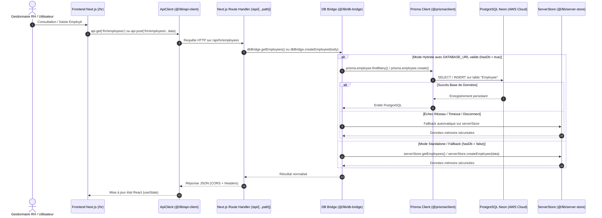

# SILEX ERP — Architecture des Données et Cycle de Persistance RH

**Date :** 13 Novembre 2026  
**Auteur :** Architecte Logiciel Senior & Équipe Technique  
**Société :** SARL SILEX SERVICES  
**Contexte :** Phase 5 — Module 04 Ressources Humaines & Mobilité Chantiers  

---

## 1. Traçage du Cycle Complet d'un Employé

L'analyse du code source existant révèle le flux d'exécution suivant pour les flux RH :

---

## 2. Détermination de la Source de Vérité

1. **Source de Vérité Principale en Production :**  
   - La base **PostgreSQL Neon** via **Prisma ORM** (`model Employee`, `model EmployeeCertification`, `model Attendance`).
   - Toutes les écritures réussies via `dbBridge` sont immédiatement commitées dans PostgreSQL Neon.

2. **Rôle de `server-store.ts` :**  
   - `server-store.ts` agit comme **adaptateur de secours haute disponibilité (Fallback Adapter)** et **moteur de démonstration isolé (Demo Sandbox)**.
   - Il garantit la continuité de service en cas d'indisponibilité réseau vers Neon, pour les tests E2E hors ligne, et isole les profils de simulation (DEMO) pour empêcher toute pollution des enregistrements réels.
   - **Règle absolue d'architecture :** `server-store.ts` ne doit JAMAIS entrer en collision avec Neon ni écraser les identifiants réels. `dbBridge` synchronise la lecture en interrogeant prioritairement Prisma, et ne bascule vers `serverStore` qu'en cas d'absence ou d'échec de la base.

---

## 3. Positionnement de l'API NestJS (`apps/api`)

- Le service NestJS `apps/api/src/modules/hr/hr.service.ts` implémente les endpoints REST directs sur `/hr/employees` avec `@Injectable() PrismaService`.
- L'application Web Next.js 15 utilise sa propre passerelle Next.js API Routes (`apps/web/src/app/api/[...path]/route.ts`) couplée à `db-bridge.ts`.
- Cette architecture permet à la fois :
  - L'accès interne direct et unifié via Next.js SSR / API Routes.
  - L'accès par des microservices ou applications tierces via l'API NestJS.

---

## 4. Politique de Sécurité et Étanchéité des Données Collaborateurs

1. **Vérification de la base Neon :**  
   - La table `Employee` dans Neon a été vérifiée en lecture seule : **0 enregistrement actuel**.
   - Aucune donnée personnelle ni salariale réelle n'est présente ni ne sera insérée.
2. **Identification Démo :**  
   - Tous les collaborateurs créés pour la démonstration et les tests portent la nomenclature stricte `DEMO-EMP-001` à `DEMO-EMP-012`.
   - Les numéros de téléphone sont fictifs (`+213 550 00 00 XX`), les adresses sont génériques et les matricules débutent par `DEMO-MAT-`.
3. **Dissociation Salariés vs Utilisateurs ERP :**  
   - Les employés inscrits au registre du personnel (ouvriers tuyauteurs, soudeurs, aides-monteurs) ne disposent pas par défaut d'un compte utilisateur ERP (`User`).
   - Seuls les collaborateurs occupant un poste de supervision ou de direction ont un compte ERP doté d'un rôle RBAC spécifique (`CHEF_CHANTIER`, `RESPONSABLE_RH`, `RESPONSABLE_PROJET`, `DIRECTION_GENERALE`).
