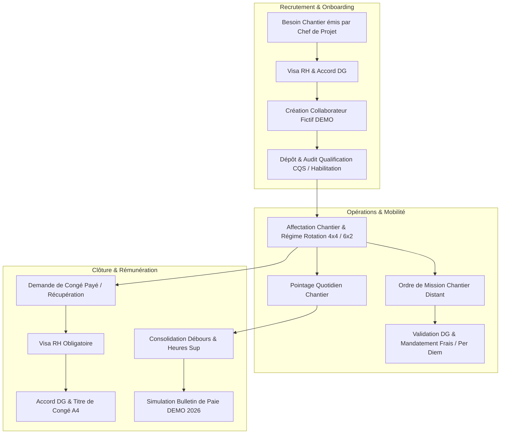

# WORKFLOWS OPÉRATIONNELS DU MODULE RESSOURCES HUMAINES & MOBILITÉ
**ERP SARL SILEX SERVICES — Version 2026**
Fichier : `docs/SILEX_HR_WORKFLOWS.md`

---

## 1. Vue d'Ensemble des Processus RH Industriels

Dans le secteur de la maintenance, de la tuyauterie industrielle et de la construction d'ouvrages pétroliers, le module RH de SILEX SERVICES gère le capital humain avec des contraintes opérationnelles fortes :
- **Ségrégation stricte des tâches (SoD)** : Le demandeur ou le chef de projet ne peut pas valider lui-même les congés ou les mobilités sans visa RH et accord DG.
- **Conformité technique CQS** : Aucun opérateur ne peut être affecté sur des tuyauteries sous pression ou en zone ATEX sans qualification de soudage (ASME IX / ISO 9606) valide et auditée.
- **Régimes Sahariens Sud** : Cycles de travail en 4×4 ou 6×2 nécessitant une rotation fluide et le calcul précis des indemnités kilométriques et per diem.

---

## 2. Diagramme Global des Cycles de Vie Métier

---

## 3. Détail des Circuits de Validation

### 3.1 Circuit d'Approbation des Demandes de Congé (`RH-05`)
1. **Émission** : Le collaborateur ou son supérieur émet la demande de congé (`LV-XXXX`). Statut : `SOUMIS`.
2. **Visa RH Préalable Obligatoire** : Le Responsable RH vérifie le solde acquis, la planification des relèves de chantier et appose son visa (`VISA-RH-XXXX`). Statut : `VISE_RH`.
3. **Arbitrage Direction Générale** : La DG examine l'impact sur les plannings contractuels et valide (`ACCORDE_DG`) ou refuse avec motif.
4. **Édition Documentaire** : Génération automatique du **Titre de Congé A4** officiel avec filigrane DEMO.

> [!IMPORTANT]
> **Règle SoD** : Toute tentative d'approbation directe par la DG sans visa RH préalable est bloquée au niveau de l'API et du service métier (`server-store.ts`).

### 3.2 Circuit des Ordres de Mission Chantiers (`RH-06`)
1. **Création de la Mission** : Précision du motif, du lieu d'intervention (ex: Skikda, Arzew, Hassi Messaoud), du véhicule et des avances de frais.
2. **Calcul des Indemnités Journalières (Per Diem)** : Application automatique du barème de frais de mission selon la zone géographique.
3. **Visa Direction Générale** : Accord DG impératif avant départ du collaborateur.
4. **Mise à jour du Statut RH** : Le statut de l'employé bascule automatiquement sur `EN_MISSION`.

### 3.3 Expression de Besoins en Recrutement (`RH-07`)
1. **Détection du Besoin** : Le Responsable de Projet constate un déficit de compétences (ex: soudeurs 6G, tuyauteurs qualifiés).
2. **Soumission de la Fiche Besoin** : Spécification du nombre de postes, de la durée estimée et de la date requise.
3. **Accord DG** : Autorisation de lancement du recrutement par la Direction Générale.
4. **Clôture** : Conversion en profils collaborateurs une fois le recrutement finalisé.

---

## 4. Gestion des Qualifications & Audits CQS (`RH-02`)

Pour garantir l'excellence technique et la conformité aux exigences Sonatrach / Sonelgaz :
- Les certifications sont catégorisées par norme (`ASME IX`, `ISO 9606-1`, `NF EN 287-1`, `Habilitation Électrique UTE C18-510`).
- Les statuts de validité sont audités : `EN_ATTENTE_VERIFICATION` → `VALIDE` ou `REJETE` avec consignation de l'auditeur HSE et du motif.
- Reconduction périodique à 6 mois sous visa ASME IX QW-322.

---
*SARL SILEX SERVICES — Direction des Ressources Humaines & Opérations Chantiers.*
