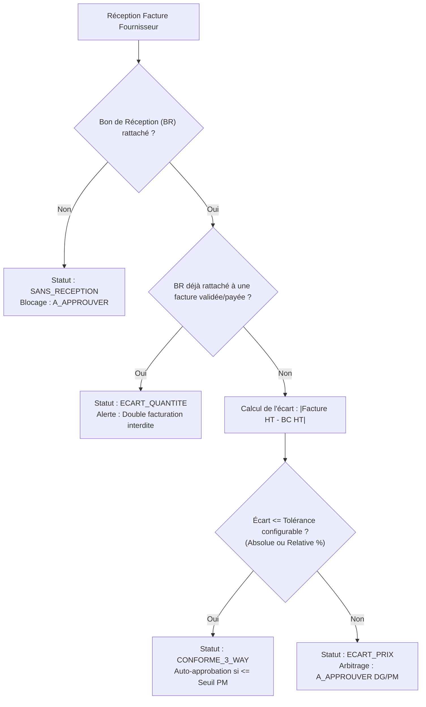

# RAPPORT DE COHÉRENCE COMPTABLE & 3-WAY MATCHING AVANCÉ — PHASE 6B.2
## SILEX SERVICES ERP — Éradication du Double Comptage & Algorithme de Rapprochement

> **Statut de l'Audit Comptable :** VALIDÉ ET CONFORME  
> **Date :** 14 Novembre 2026  
> **Composants :** `apps/web/src/lib/server-store.ts`, `apps/web/src/lib/db-bridge.ts`.

---

### 1. Distinction Étanche des Cycles Métier (Anti-Double-Compte)

Le système assure la séparation formelle entre les 9 notions fondamentales de la gestion industrielle :

1. **Engagement (`PurchaseOrder`) :** Réservation budgétaire contractuelle (`committedCost`), non décaissée et non stockée.
2. **Réception physique (`GoodsReceipt`) :** Constat de livraison quantitative et qualitative sur magasin (génère un mouvement `StockMovement` de type `PURCHASE_RECEIPT`). Ne crée aucune dette financière exigible.
3. **Entrée en stock :** Incrément des quantités en magasin (`warehouse.inventoryItems`).
4. **Consommation chantier :** Sortie magasin imputée sur un code projet (`ProjectCostEntry` de catégorie `MATIERE_STOCK`).
5. **Charge projet :** Reconnue lors de la consommation réelle (fournitures sorties + heures de pointage effectives + prestations sous-traitées).
6. **Facture Fournisseur (`SupplierInvoice`) :** Constatation de l'exigibilité juridique et fiscale de la créance du tiers.
7. **Dette Fournisseur :** Solde résiduel dû au fournisseur (`remainingAmount`).
8. **Paiement Fournisseur :** Règlement monétaire débitant le compte bancaire et éteignant la dette au passif.
9. **Flux de trésorerie (`CashTransaction`) :** Écriture bancaire unitaire.

> [!IMPORTANT]
> **Règle absolue vérifiée :** Le règlement d'une facture fournisseur n'émet **aucune écriture de charge** dans `project.costEntries`. La rentabilité du projet n'est impactée qu'une seule fois, au moment de la livraison ou de la consommation réelle.

---

### 2. Algorithme de 3-Way Matching Avancé

L'algorithme de rapprochement a été refondu pour intégrer les améliorations demandées :

#### Nouveautés opérationnelles de la Phase 6B.2 :
1. **Paramétrage dynamique des tolérances :**
   - Tolérance absolue : `financialConfig.priceToleranceAbsoluteDA` (par défaut 100 DA, modifiable par la DG).
   - Tolérance relative : `financialConfig.priceToleranceRelativePct` (par défaut 0.5%).
   - Si l'écart se situe en deçà de l'une des deux tolérances, la facture est reconnue `CONFORME_3_WAY`.
2. **Protection Anti-Double Facturation :**
   - Le système inspecte l'historique : si le BR a déjà été rattaché à une facture approuvée, payée ou en cours de paiement, la tentative de réutilisation est immédiatement interceptée avec le statut `ECART_QUANTITE`.
3. **Multi-Rapprochement :**
   - Le modèle prend désormais en charge un tableau `goodsReceiptIds: string[]` pour agréger plusieurs bons de livraison sur une facture récapitulative unique.

---

### 3. Calcul de Rentabilité Réelle par Projet

La méthode `getProjectProfitability(projectId)` consolide les flux réels sans mélange entre trésorerie et exploitation :
- **Chiffre d'Affaires :** Montant contractuel vendu vs Chiffre d'affaires facturé aux situations de travaux.
- **Coûts Réels Déboursés :**
  - Matières : Quantités réceptionnées conformes × prix unitaire du bon de commande.
  - Main-d'œuvre : Heures de pointage réelles validées sur chantier × taux horaire.
  - Frais & Sous-traitance : Dépenses directes hors consommations stock.
- **Marge Réelle de Chantier :** CA facturé HT − Coûts réels directs = Marge Brute en DA et en pourcentage.
