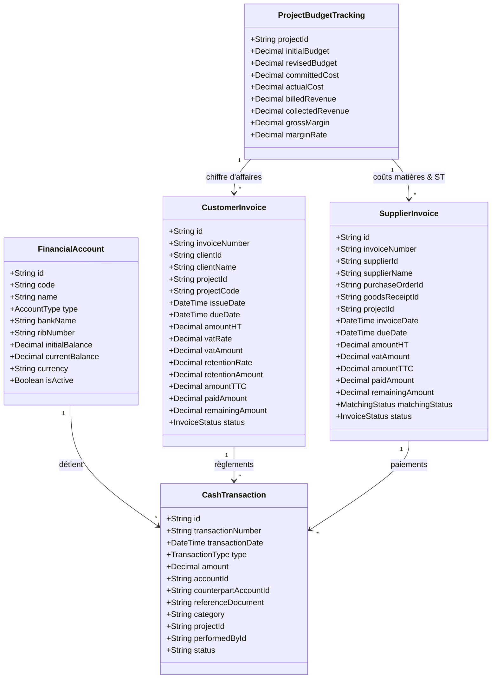

# ARCHITECTURE DU SYSTÈME FINANCIER & CONVERGENCE ERP
**ERP INDUSTRIEL SARL SILEX SERVICES — Version 2026**  
**Document de Référence : Phase 6A (Architecture Cible)**  
**Fichier :** `docs/SILEX_PHASE6_FINANCE_ARCHITECTURE.md`

---

## 1. VISION & PRINCIPES ARCHITECTURAUX

Le module Finance agit comme le **grand livre opérationnel et analytique** de SARL SILEX SERVICES. Il assure la convergence de tous les flux physiques, contractuels et humains vers des écritures et soldes financiers rigoureux.

### Principes directeurs :
1. **Source Unique de Vérité (SSOT)** : Aucun montant ne doit être saisi manuellement s'il dérive d'un devis, d'un pointage, d'une réception ou d'une commande.
2. **Double Écriture & Atomicité des Flux de Trésorerie** : Tout virement entre comptes (ex: Banque BEA $\rightarrow$ Caisse Chantier) génère deux mouvements liés dans une transaction SQL atomique.
3. **Prévention Absolue du Double Comptage Budgétaire** :
   $$\text{Budget Restant} = \text{Budget Révisé} - (\text{Dépenses Réelles Décaisées} + \text{Engagements Restants non Facturés})$$
4. **Précision Décimale Monétaire** : Tous les calculs financiers sont modélisés en `Decimal` (ou entiers en centimes/DA stricts) avec arrondi commercial à deux décimales, sans aucune dérive de virgule flottante JavaScript.
5. **Idempotence des Règlements** : Chaque opération de paiement porte un jeton d'idempotence (`idempotencyKey`) empêchant les doubles débits en cas de double clic ou retry réseau.

---

## 2. MODÈLE CONCEPTUEL & RELATIONS INTER-MODULES

---

## 3. RAPPROCHEMENT À 3 NIVEAUX FOURNISSEURS (3-WAY MATCHING)

Pour chaque facture reçue d'un fournisseur industriel (tubes, vannes, engins de levage, sous-traitance CND) :
1. **Vérification Niveau 1 (Bon de Commande BC-2026)** : Prix unitaires contractuels, devises, remises et conditions de paiement.
2. **Vérification Niveau 2 (Bon de Réception BR-2026)** : Quantités physiquement réceptionnées en magasin central ou sur chantier et acceptées au contrôle qualité (exclusion des rebuts en quarantaine).
3. **Vérification Niveau 3 (Facture Fournisseur)** : Confrontation arithmétique :
   - Écart Quantité : `Quantité Facturée - Quantité Réceptionnée`.
   - Écart Prix : `(Prix Unitaire Facturé - Prix Unitaire BC) * Quantité`.
   - Si $\text{Écart} > 0$ : Blocage automatique et mise en statut `LITIGE_CONTROLE` avec notification au Responsable Achats et Finance.

---

## 4. CALCUL DU VIEILLISSEMENT DES CRÉANCES & BALANCE ÂGÉE (AGED TRIAL BALANCE)

Les créances clients sont automatiquement ventilées par tranches de maturité par rapport à la date du jour :
- **Courant / Non Échu** : $\text{Date d'Échéance} \ge \text{Date du Jour}$.
- **Échu 1 à 30 jours** : Retard entre 1 et 30 jours (Relance 1 automatique).
- **Échu 31 à 60 jours** : Retard entre 31 et 60 jours (Relance 2 avec avis hiérarchique).
- **Échu 61 à 90 jours** : Retard critique (Mise en demeure / Blocage nouvelles commandes).
- **Plus de 90 jours** : Créance douteuse / Contentieux.

---

## 5. TRAÇABILITÉ, SÉGRÉGATION DES TÂCHES & WORKFLOWS DE VALIDATION (SoD)

| Opération Financière | Initiateur | Contrôleur / Vérificateur | Décideur / Approbateur | Règle SoD Immuable |
|---|---|---|---|---|
| **Émission Facture Client** | Chargé Facturation / Resp. Projet | Resp. Financier | Directeur Général | L'émetteur ne valide pas le départ officiel. |
| **Enregistrement Facture Fournisseur** | Gestionnaire Fournisseurs | Resp. Achats | Resp. Financier | Rapprochement 3-Way matching obligatoire. |
| **Ordonnancement Paiement Fournisseur** | Comptable Fournisseurs | Resp. Financier | Directeur Général | Double signature au-delà de 500 000 DA. |
| **Virement Interne de Trésorerie** | Trésorier | Resp. Financier | Directeur Général | Rapprochement bancaire contradictoire. |
| **Libération Retenue Garantie 5%** | Resp. Projet (PV Définitif) | Resp. Financier | Directeur Général | PV contradictoire client obligatoire. |

---
*SARL SILEX SERVICES — Architecture du Système d'Information Financier.*
