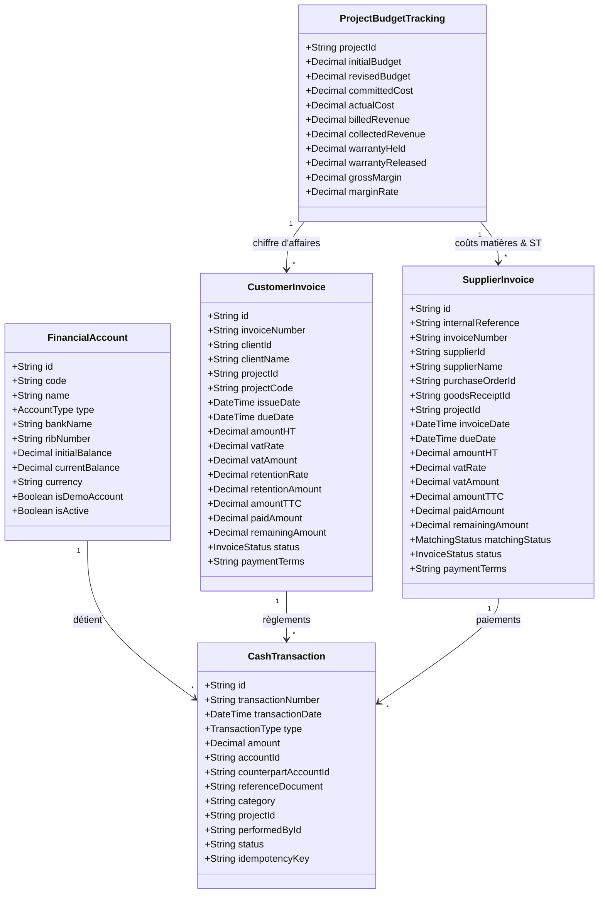

# ARCHITECTURE DU SYSTÈME FINANCIER & CONVERGENCE ERP
**ERP INDUSTRIEL SARL SILEX SERVICES — Version 2026**  
**Document de Référence : Phase 6A (Architecture Cible Révisée)**  
**Fichier :** `docs/SILEX_PHASE6_FINANCE_ARCHITECTURE.md`

---

## 1. VISION & PRINCIPES ARCHITECTURAUX

Le module Finance agit comme le **grand livre opérationnel et analytique** de SARL SILEX SERVICES. Il assure la convergence de tous les flux physiques, contractuels et humains vers des écritures et soldes financiers rigoureux.

### Principes directeurs :
1. **Source Unique de Vérité (SSOT)** : Aucun montant ne doit être ressaisi manuellement s'il dérive d'un devis, d'un pointage, d'une réception ou d'une commande.
2. **Double Écriture & Atomicité des Flux de Trésorerie** : Tout virement entre comptes financiers génère deux mouvements liés dans une transaction SQL atomique (Débit compte source / Crédit compte destinataire).
3. **Prévention Absolue du Double Comptage Budgétaire** :
   $$\text{Budget Restant} = \text{Budget Révisé} - (\text{Coûts Réels Consommés} + \text{Engagements Restants non Facturés})$$
   - Un bon de commande émis constitue un **engagement**.
   - Lors de la réception de la facture fournisseur puis de son règlement, l'engagement est liquidé et transformé en **coût réel consommé**, sans jamais additionner la commande en cours et la facture payée.
4. **Distinction Stricte de la Chaîne d'Achat & Dépense** :
   - *Commande engagée* $\ne$ *Réception magasin* $\ne$ *Facture reçue* $\ne$ *Dette reconnue* $\ne$ *Paiement décaissé*.
5. **Précision Décimale Monétaire** : Tous les calculs financiers sont modélisés en `Decimal` avec arrondi commercial à deux décimales, sans aucune dérive de virgule flottante JavaScript.
6. **Idempotence des Règlements** : Chaque opération de paiement porte un jeton d'idempotence (`idempotencyKey`) empêchant les doubles débits en cas de double clic ou de retry réseau.
7. **Isolation Stricte des Données DEMO** : Les comptes bancaires de démonstration portent des références explicites `DEMO-CPT-*` avec des soldes artificiels, évitant toute confusion avec les avoirs réels de l'entreprise.

---

## 2. MODÈLE CONCEPTUEL & RELATIONS INTER-MODULES

---

## 3. RAPPROCHEMENT À 3 NIVEAUX FOURNISSEURS (3-WAY MATCHING)

Pour chaque facture reçue d'un fournisseur industriel (tubes, vannes, engins de levage, sous-traitance CND) :
1. **Vérification Niveau 1 (Bon de Commande BC)** : Prix unitaires contractuels, devises, remises et conditions de paiement négociées.
2. **Vérification Niveau 2 (Bon de Réception BR)** : Quantités physiquement réceptionnées en magasin ou sur chantier et acceptées au contrôle qualité (exclusion des rebuts en quarantaine).
3. **Vérification Niveau 3 (Facture Fournisseur)** : Confrontation arithmétique :
   - Écart Quantité : $\text{Quantité Facturée} - \text{Quantité Réceptionnée}$.
   - Écart Prix : $(\text{Prix Unitaire Facturé} - \text{Prix Unitaire BC}) \times \text{Quantité}$.
   - Si $\text{Écart} > 0$ : Blocage automatique et mise en statut `LITIGE_CONTROLE` avec alerte transmise aux Responsables Achats et Finance.

---

## 4. CONDITIONS CONTRACTUELLES & CONFIGURABILITÉ DES RÈGLES

### 4.1 Délais et Modalités de Paiement Paramétrables
- Les délais de règlement ne sont pas figés universellement à 30 ou 60 jours :
  - **Par Client / Marché** : Définis au niveau du contrat ou du bon de commande (ex: 30j, 45j, 60j fin de mois, ou paiement à terme d'attachement).
  - **Par Fournisseur** : Configurés selon l'accord-cadre fournisseur (au comptant, 30j fin de mois, 60j).

### 4.2 Régime Fiscal & TVA Flexible
- Le taux de TVA n'est pas codé en dur à 19% :
  - Taux standard : 19%.
  - Taux réduit : 9% (applicable selon nomenclature).
  - Exonération ANDI / Conventions spécifiques : 0% avec obligation de renseignement du numéro de visa d'exonération fiscale.

### 4.3 Retenues de Garantie Contractuelles
- Calculées strictement selon la clause du marché (taux configurable : 5%, 10% ou 0% si caution bancaire de bonne exécution substituée).
- Suivi individualisé par facture :
  - Montant retenu consigné au passif.
  - Date d'échéance de parfait achèvement (usuellement 1 an post-réception provisoire).
  - Libération soumise à l'enregistrement du Procès-Verbal de Réception Définitive (PVRD).

### 4.4 Seuils d'Arbitrage DG Paramétrables
- Les seuils d'autorisation de décaissement sont configurables dans les paramètres généraux de l'entreprise (et non gravés dans le code).
- Exemple de configuration DEMO :
  - Décaissement $\le \text{Seuil N1}$ (ex: 200 000 DA) : Validation Responsable Financier.
  - Décaissement $> \text{Seuil N1}$ : Double visa obligatoire Responsable Financier + Directeur Général.

---

## 5. CALCUL DU VIEILLISSEMENT DES CRÉANCES & BALANCE ÂGÉE (AGED TRIAL BALANCE)

Les créances clients sont automatiquement ventilées par tranches de maturité par rapport à la date de référence :
- **Courant / Non Échu** : $\text{Date d'Échéance} \ge \text{Date de Référence}$.
- **Échu 1 à 30 jours** : Retard entre 1 et 30 jours (Relance 1 amiable).
- **Échu 31 à 60 jours** : Retard entre 31 et 60 jours (Relance 2 avec notification hiérarchique).
- **Échu 61 à 90 jours** : Retard critique (Mise en demeure commerciale).
- **Plus de 90 jours** : Créance douteuse / Passage en pré-contentieux.

---

## 6. TRAÇABILITÉ, SÉGRÉGATION DES TÂCHES & WORKFLOWS DE VALIDATION (SoD)

| Opération Financière | Initiateur | Contrôleur / Vérificateur | Décideur / Approbateur | Règle SoD Immuable |
|---|---|---|---|---|
| **Émission Facture Client** | Chargé Facturation / Resp. Projet | Resp. Financier | Directeur Général | L'émetteur ne valide pas le départ officiel. |
| **Enregistrement Facture Fournisseur** | Gestionnaire Fournisseurs | Resp. Achats | Resp. Financier | Rapprochement 3-Way matching obligatoire. |
| **Ordonnancement Paiement Fournisseur** | Comptable Fournisseurs | Resp. Financier | Directeur Général (si > Seuil) | Respect des seuils de validation configurables. |
| **Virement Interne de Trésorerie** | Trésorier | Resp. Financier | Directeur Général | Rapprochement bancaire contradictoire. |
| **Libération Retenue Garantie** | Resp. Projet (PVRD) | Resp. Financier | Directeur Général | PV contradictoire client obligatoire. |

---
*SARL SILEX SERVICES — Architecture du Système d'Information Financier.*
