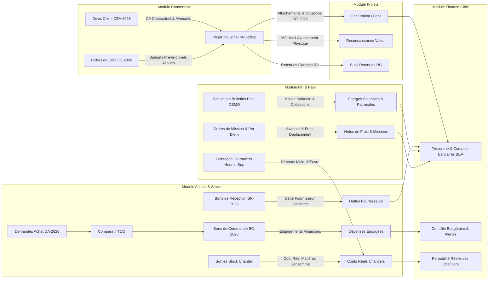

# AUDIT D'ARCHITECTURE & ÉTAT DE L'EXISTANT — MODULE FINANCE
**ERP INDUSTRIEL SARL SILEX SERVICES — Version 2026**  
**Document de Référence : Phase 6A (Audit Préalable)**  
**Fichier :** `docs/SILEX_PHASE6_FINANCE_AUDIT.md`  
**Date d'audit :** 13 Novembre 2026

---

## 1. ÉTAT RÉEL DU DÉPÔT & CONTEXTE ARCHITECTURAL

L'audit technique mené sur le dépôt PNPM monorepo confirme l'architecture suivante :
- **Backend API (`apps/api`)** : NestJS 11, Swagger, JWT Auth Guards, RBAC par rôles (`@silex/shared`), contrôleurs modulaires.
- **Frontend Web (`apps/web`)** : Next.js 15.5.29 App Router (React 19, Tailwind CSS 4, Lucide Icons, Recharts), passerelle d'API interne `apps/web/src/app/api/[...path]/route.ts`.
- **Base de données & ORM** : PostgreSQL Neon avec Prisma ORM (35 modèles actuels dans `apps/web/prisma/schema.prisma`).
- **Passerelle Hybride Persistance** : `db-bridge.ts` assurant la sérialisation avec PostgreSQL Neon et bascule contrôlée vers le store singleton `server-store.ts` avec barrière stricte en production (`isProductionStrict`).

---

## 2. CARTOGRAPHIE DES FLUX FINANCIERS EXISTANTS ENTRE LES MODULES

Le tableau suivant retrace les flux financiers amont et leur état d'interconnexion actuel :

---

## 3. AUDIT DÉTAILLÉ DES MODÈLES & DONNÉES FINANCIÈRES ACTUELLES

| Entité Métier | Définition Actuelle | Persistance Actuelle | Création / Modification | Validation | Utilisation Actuelle | Statut de Couverture |
|---|---|---|---|---|---|---|
| **Devis Client (CustomerQuote)** | `server-store.ts` | Mémoire volatile & Project | Resp. Commercial | DG | Commercial, Projets | ✅ Testé E2E Commercial |
| **Budget Projet (budgetAmount)** | `schema.prisma` (`Project`) | Neon PostgreSQL & Store | Resp. Projet | DG | Projets, Finance | ✅ Testé E2E Projets |
| **Engagements Achats (PO)** | `schema.prisma` (`PurchaseOrder`) | Neon PostgreSQL & Store | Resp. Achats | DG (via TCO) | Procurement, Finance | ✅ Testé E2E Achats |
| **Dépenses Chantier (ProjectCostEntry)**| `schema.prisma` | Neon PostgreSQL & Store | Chef Projet / Magasin | Resp. Projet | Projets, Finance | ✅ Testé E2E Projets |
| **Situations Travaux (WorkSituation)** | `schema.prisma` | Neon PostgreSQL & Store | Resp. Projet | DG | Projets, Finance | ✅ Testé E2E Projets |
| **Retenue Garantie (warrantyHeld)** | Calcul 5% situation | Mémoire & Description | Finance | DG | Finance | ⚠️ Partiel (texte libre) |
| **Encaissements Clients (Payments)** | `serverStore.financePayments` | Mémoire volatile | Resp. Financier | - | `/finance` | ⚠️ Incomplet (pas de compte) |
| **Comptes Bancaires & Caisses** | **ABSENT** | **AUCUNE** | - | - | - | ❌ **À DÉVELOPPER (P0)** |
| **Mouvements de Trésorerie (Flux)** | **ABSENT** | **AUCUNE** | - | - | - | ❌ **À DÉVELOPPER (P0)** |
| **Factures Clients Formelles (A4)** | Situations brutes | **AUCUNE** | - | - | - | ❌ **À DÉVELOPPER (P0)** |
| **Factures Fournisseurs (Rapprochement)**| **ABSENT** | **AUCUNE** | - | - | - | ❌ **À DÉVELOPPER (P0)** |
| **Balance Âgée Créances / Dettes** | Calcul partiel client | **AUCUNE** | - | - | - | ❌ **À DÉVELOPPER (P0)** |
| **Liaison Paie RH $\rightarrow$ Finance** | `calculatePayslipDemo` | RH Store | Resp. RH | DG | RH uniquement | ❌ **À INTERCONNECTER (P0)** |

---

## 4. INCOHÉRENCES DÉTECTÉES & RISQUES IDENTIFIÉS

1. **Calcul de Trésorerie Fictif** :
   - Dans le code existant (`apps/web/src/lib/server-store.ts:3640`), la trésorerie est calculée comme :
     `treasuryBalance = totalCollected - totalPOExpenditure`.
   - **Anomalie critique** : Cela soustrait le total des **engagements de commandes d'achat** (qui ne sont pas encore payés) des encaissements clients reçus, sans tenir compte :
     - des soldes initiaux des comptes bancaires réels (ex: compte BEA Entreprises, compte BNA, caisse de chantier) ;
     - des factures fournisseurs réelles non encore échues ;
     - des décaissements réels de salaires et de frais de mission.
2. **Absence de Rapprochement à 3 Niveaux (3-Way Matching)** :
   - Actuellement, une commande passée dans le module Achats incrémente les engagements, et une réception incrémente le stock. Mais il n'existe aucune entité `SupplierInvoice` pour constater la dette fiscale et comptable, contrôler les écarts de prix/quantité et ordonnancer le règlement.
3. **Risque de Double Comptage Budgétaire** :
   - Lors de la conversion d'une commande d'achat en facture puis en paiement, il y a risque de compter à la fois la commande engagée et la dépense réelle comme deux consommations distinctes du budget de chantier si un identifiant de liaison unique (`commitmentId`) n'est pas maintenu.
4. **Déconnexion des Coûts RH Validés** :
   - Les débours RH calculés avec précision en Phase 5C (salaires nets, CNAS salariale 9%, CNAS patronale 26%, œuvres sociales 1%, IRG légal DGI et indemnités de déplacement) ne sont pas encore consolidés dans le tableau de bord de la direction financière.

---

## 5. DÉCISIONS MÉTIER À SOUMETTRE À LA VALIDATION DE SILEX SERVICES

1. **Comptes Bancaires d'Exploitation** :
   - Définition des comptes officiels (ex: Compte Courant BEA Agence Arzew, Compte BNA Skikda, Caisse Régie Chantiers).
2. **Conditions Contractuelles Standards de Règlement** :
   - Délais usuels clients (ex: 60 jours fin de mois pour Sonatrach, 45 jours pour les industriels privés).
   - Délais de paiement fournisseurs (ex: 30 jours fin de mois, paiement à la livraison pour les consommables urgents).
3. **Régime Fiscal de Facturation Client** :
   - Application de la TVA normale à 19% avec retenue à la source ou exonération ANDI / Anvredet sur présentation d'attestation d'exonération visée par les services fiscaux.

---
*SARL SILEX SERVICES — Direction Financière & Architecture Logicielle.*
