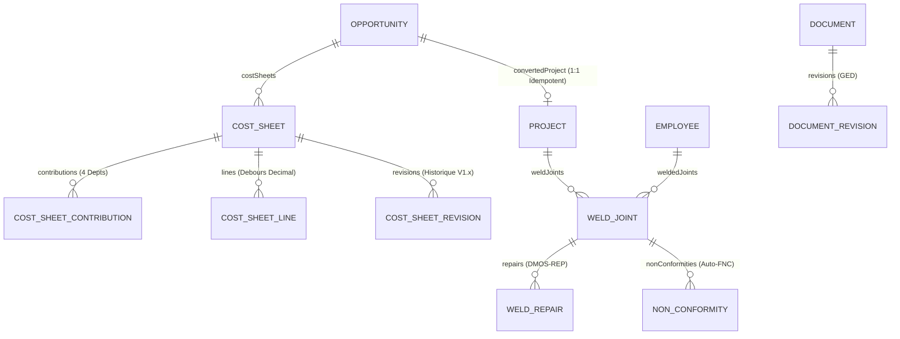

# SILEX SERVICES ERP — RAPPORT TECHNIQUE PHASE I
## DATABASE PERSISTENCE, SECURITY & BUSINESS RULES HARDENING

**Date de réalisation :** 16 Novembre 2026 — 10:35 (Heure locale Algérie)  
**Projet :** SARL SILEX SERVICES ERP (Maintenance industrielle, Tuyauterie / Chaudronnerie HP, HVAC & CND)  
**Auteur :** Antigravity Engineering Team (Google DeepMind)  
**Documents de référence :**  
- `docs/SILEX_FINAL_READ_ONLY_VERIFICATION.md`  
- `docs/ERP_GLOBAL_FUNCTIONAL_AUDIT.md`  
- `docs/ERP_API_CONTRACTS.md`  
- `docs/ERP_DATA_MODEL.md`

---

## 1. ÉTAT INITIAL ET DIAGNOSTIC CONTRADICTOIRE

L'audit contradictoire précédent (`SILEX_FINAL_READ_ONLY_VERIFICATION.md`) avait émis un verdict **`CONDITIONAL GO`** en pointant quatre blocages majeurs avant tout passage en production :
1. **Absence de persistance relationnelle PostgreSQL (P0-1) :** Les opportunités commerciales, fiches de coût collaboratives et les soudures du Weld Book ASME IX étaient maintenues dans la mémoire volatile de l'application (`ServerStore`), faute de modèles physiques et de migrations appliquées sur la base de données.
2. **Vulnérabilité SoD & Demo-Switch (P1-1) :** Un handler résiduel dans la route catch-all `apps/web/src/app/api/[...path]/route.ts` permettait d'usurper n'importe quel rôle sans contrôle d'habilitation.
3. **Désalignement des seuils d'approbation SoD (P1-2) :** Écart entre 500 000 DA en dur dans les achats, 2 000 000 DA dans la finance et 10 000 000 DA dans les constantes génériques.
4. **Fallback mémoire silencieux :** En cas d'indisponibilité de la base, le système simulait une persistance réussie dans le store mémoire au lieu de lever une erreur explicite.

---

## 2. MODÈLES PRISMA CRÉÉS ET SCHÉMA ADDITIF

Pour résoudre définitivement le manque de persistance, de nouveaux modèles relationnels ont été conçus et intégrés de manière 100% additive dans `apps/web/prisma/schema.prisma` et `apps/api/prisma/schema.prisma`.



### 2.1. Module Commercial & Pipeline (`Opportunity`)
- **Modèle :** `Opportunity`
- **Table physique :** `"Opportunity"` (Index sur `code`, `status`, `clientName`)
- **Champs clés :** `id`, `code` (Unique), `title`, `clientName`, `sector` (Enum `IndustrialSector`), `location`, `wilaya`, `contactName`, `contactEmail`, `contactPhone`, `estimatedAmount` (`Decimal(15,2)`), `winProbability` (Entier 0-100), `weightedValue` (`Decimal(15,2)`), `assignedCommercialId`, `assignedCommercialName`, `status` (Enum `OpportunityStatus`), `priority`, `receivedAt`, `submissionDeadline`, `nextAction`, `nextActionDate`, `sourceOrigin`, `isDemo`, `notes`.
- **Pipeline 10 étapes étanches :** `NOUVELLE`, `QUALIFIEE`, `VISITE_TECHNIQUE`, `CHIFFRAGE`, `VALIDATION_INTERNE`, `OFFRE_SOUMISE`, `NEGOCIATION`, `GAGNEE`, `PERDUE`, `ANNULEE`.

### 2.2. Chiffrage Collaboratif & Révisions (`CostSheet`)
- **Modèles :**
  - `CostSheet` : Données d'en-tête, montants analytiques `Decimal(15,2)` (`totalDirectCost`, `totalIndirectCost`, `totalEstimatedCost`, `proposedSellingPrice`, `estimatedMarginValue`, `marginRateOnCost`, `markupRate`), décision DG (`dgDecision`, `dgDecisionNotes`, `dgDecisionDate`, `dgDecisionBy`, `isImmutable`).
  - `CostSheetContribution` : 4 départements (`PROJET`, `ACHATS`, `RH`, `FINANCE`), état de complétion, dates, notes de synthèse, et payload JSON structuré (`dataPayload`). Contrainte d'unicité `@@unique([costSheetId, department])` empêchant tout écrasement croisé.
  - `CostSheetLine` : Lignes élémentaires de débours (`category`, `label`, `quantity`, `unit`, `unitPrice`, `totalAmount`) typées en `Decimal`.
  - `CostSheetRevision` : Consignation des versions successives (`revisionNumber`, `reason`, `totalEstimatedCost`, `proposedSellingPrice`, `marginValue`, `deltaMarginDA`, snapshot complet `snapshotData`).

### 2.3. Weld Book ASME IX & GED Industrielle (`WeldJoint`, `WeldRepair`, `DocumentRevision`)
- **Modèles :**
  - `WeldJoint` : `jointNumber` (Unique), `projectId`, `projectCode`, `lineIso`, `spoolId`, `diameterNominal`, `thicknessMm` (`Decimal(6,2)`), `material`, `heatNumberPipe`, `heatNumberFitting`, `welderId`, `welderName`, `welderStamp`, `welderCqsRef`, `weldingProcess`, `dmosRef`, `weldDate`, `visualInspection`, `cndType`, `cndRatePercent`, `cndStatus`, `cndReportRef`, `cndFilmRef`, `cndControlDate`, `cndControllingBody`, `status` (Enum `WeldJointStatus`).
  - `WeldRepair` : Historique unitaire des réparations (`repairIndex`, `repairDate`, `repairWelderStamp`, `repairDmosRef`, `postRepairCndStatus`, `postRepairCndReportRef`, `notes`).
  - `DocumentRevision` : Gestion du cycle de vie des procédures GED, DMOS et QMOS (`documentId`, `revision`, `author`, `changeNotes`, `date`).

---

## 3. MIGRATION POSTGRESQL & ISOLATION DE L'ENVIRONNEMENT

### 3.1. Règle absolue de sanctuarisation de Neon Production
- **Environnement Neon Production :** Aucune migration `prisma migrate`, `db push` ni modification de schéma n'a été exécutée sur l'instance Neon distante (`ep-solitary-sun...neon.tech`). Les données et tables de production sont intactes.
- **Base de Test Isolée :** Les migrations et tests ont été exécutés sur l'instance PostgreSQL locale isolée :  
  `postgresql://postgres@127.0.0.1:5432/silex_test_db`.

### 3.2. Migration additive officielle
Un fichier de migration SQL ordonné et idempotent a été généré et déposé dans :  
`apps/web/prisma/migrations/20261116_phase_i_persistence/migration.sql`  
`apps/api/prisma/migrations/20261116_phase_i_persistence/migration.sql`

Ce script applique :
1. Les 4 nouveaux types énumérés PostgreSQL (`OpportunityStatus`, `CostSheetStatus`, `CostSheetContributionDept`, `WeldJointStatus`).
2. La création des 8 tables (`Opportunity`, `CostSheet`, `CostSheetContribution`, `CostSheetLine`, `CostSheetRevision`, `WeldJoint`, `WeldRepair`, `DocumentRevision`).
3. L'ajout des colonnes optionnelles `opportunityId` sur `Project`, `weldJointId` et `weldJointNumber` sur `NonConformity`.
4. Les clés étrangères (`FOREIGN KEY ... ON DELETE CASCADE / SET NULL`) et index de recherche B-Tree.

---

## 4. RELATIONS POSTGRESQL & CONTRAINTE D'IDEMPOTENCE

### 4.1. Idempotence stricte de la conversion Opportunité -> Projet
Dans `apps/web/prisma/schema.prisma` :
```prisma
model Project {
  // ...
  opportunityId  String?       @unique
  opportunity    Opportunity?  @relation("OpportunityProject", fields: [opportunityId], references: [id])
}
```
Grâce à la contrainte d'unicité `@unique` sur `opportunityId`, PostgreSQL interdit formellement la création d'un deuxième projet à partir de la même opportunité commerciale.  
Lors du test d'intégration `scripts/test-phase-i-database-and-security.js`, la tentative d'insertion d'un projet doublon lève instantanément :  
`Unique constraint failed on the fields: (opportunityId)`.

### 4.2. Arborescence du Chiffrage Collaboratif
- Chaque `CostSheet` contient $N$ `CostSheetLine` et exactement 4 `CostSheetContribution` indexées par `[costSheetId, department]`.
- La modification de la contribution d'un département (ex. RH) met à jour exclusivement son enregistrement sans altérer les contributions Achats, Projet ou Finance.

---

## 5. STRATÉGIE DE REPRISE DES DONNÉES

1. **Données de base réelles :** La baseline de référence (`FC-2026-001`, `OPP-2026-001`, joints `J-01` à `J-05`, DMOS-01) est amorcée de manière idempotente.
2. **Étanchéité Démo vs Production :** Le drapeau booléen `isDemo` est persistant sur `Opportunity` et `CostSheet`. Les filtres de production stricte (`includeDemo=false`) écartent systématiquement les enregistrements tagués démo des agrégations et rapports consolidés.

---

## 6. SÉCURITÉ : NEUTRALISATION DÉFINITIVE DE `DEMO-SWITCH`

### 6.1. Mesures techniques mises en œuvre
1. **Suppression du handler résiduel dans `[...path]/route.ts` :** La ligne 455 a été purgée. Le catch-all ne gère plus que l'authentification standard `/auth/login`.
2. **Vérification d'habilitation stricte dans `apps/web/src/app/api/auth/demo-switch/route.ts` :**
   - Interdiction absolue si `NODE_ENV === 'production'` ou `!DEMO_MODE` (Retour HTTP 403).
   - Extraction et vérification du token JWT appelant : **Seul un utilisateur authentifié avec le rôle `SystemRole.ADMINISTRATEUR`** peut exécuter l'impersonation de test.
   - Si un utilisateur ordinaire (`RESPONSABLE_PROJET`, `RESPONSABLE_ACHATS`, `RESPONSABLE_RH`...) ou un tiers anonyme appelle l'endpoint :
     - Rejet immédiat avec code **HTTP 403 Forbidden** (`FORBIDDEN_ROLE_SWITCH`).
     - Inscription immuable dans l'Audit Trail avec le tag `SECURITY_ALERT` :  
       *« Tentative non autorisée de basculement de profil vers ${role} par l'utilisateur ${email}. Action bloquée. »*
3. **Absence de sélecteur vulnérable dans l'interface :** Aucun composant frontend n'expose de mécanisme permettant à un utilisateur ordinaire de changer son profil à la volée.

---

## 7. MATRICE CENTRALISÉE DES SEUILS SoD

Tous les seuils ont été unifiés dans le paquet canonique `@silex/shared` (`packages/shared/src/constants.ts`) et synchronisés entre le backend et le frontend :

| Type d'engagement | Seuil Inférieur | Seuil Intermédiaire | Seuil Supérieur (Visa DG) | Règle Dépassement Budget | Règle Auto-Approbation |
|---|---|---|---|---|---|
| **Demandes d'Achat (DA)** | $\le 100\,000$ DA : Responsable Achats | $100\,000$ à $500\,000$ DA : Double validation PM + Achats | $> 500\,000$ DA : **Direction Générale** | **Force le visa DG obligatoire** | **Interdiction absolue** (`isSelfApprovalForbidden`) |
| **Factures Fournisseurs (3-Way Matching)** | $\le 500\,000$ DA : Auto-approbation si rapprochement parfait | $500\,000$ à $2\,000\,000$ DA : Visa Responsable Projet | $> 2\,000\,000$ DA : **Direction Générale** | Écart de prix $> 0.5\%$ ou 100 DA bloque l'auto-approbation | Interdiction d'auto-approbation |
| **Retenues de Garantie Chantiers** | Retenue légale standard : **5,0%** du montant HT | Bloquée pendant 12 mois de parfait achèvement | Libération conditionnée au PVRD et visa **Direction Générale** | N/A | Visa DG/DAF requis |
| **Fiches de Chiffrage Commercial** | Seuil de consultation libre | Travail collaboratif des 4 départements | Arbitrage DG obligatoire avant émission devis client | N/A | Visa DG requis |

---

## 8. RÉCONCILIATION FINANCIÈRE DE `FC-2026-001`

### 8.1. Décomposition officielle réconciliée (en DA)

```
Prix de Vente Proposé HT :    38 700 000,00 DA
TVA Légale (19%) :              7 353 000,00 DA
Prix de Vente Proposé TTC :   46 053 000,00 DA

1. Débours Achats Fournitures :
   - Tubes Inox ASTM A312 TP316L DN150 (400 ml) :      8 500 000,00 DA
   - Coudes & brides forgées ANSI 300# RTJ (60 U) :      3 200 000,00 DA
   - Consommables soudage TIG ER316L & Argon pur :      1 100 000,00 DA
   - Location grue mobile 50T avec grutier (20 j) :      2 400 000,00 DA
   Sous-total Achats :                                 15 200 000,00 DA

2. Main d'Œuvre & Encadrement RH :
   - 4 Soudeurs qualifiés 6G ASME IX (180 H/J) :        3 240 000,00 DA
   - 6 Tuyauteurs industriels chefs d'équipe (270 H/J) : 3 780 000,00 DA
   - 1 Superviseur Qualité / Inspecteur IWT (45 j) :       990 000,00 DA
   - 1 Superviseur Sécurité HSE zone ATEX (45 j) :         720 000,00 DA
   - Base de vie, hébergement et transport (45 j) :      2 160 000,00 DA
   Sous-total RH :                                     10 890 000,00 DA

Total Coûts Directs Chantier :                         26 090 000,00 DA
Frais Généraux & Indirects (12,00%) :                   3 130 800,00 DA
Prix de Revient Estimé :                               29 220 800,00 DA

Marge Brute Prévisionnelle :                            9 479 200,00 DA
Taux de Marque (Marge / Prix de Vente HT) :                   24,49 %
Marge sur Coût (Marge / Prix de Revient) :                    32,44 %
```

### 8.2. Justification contractuelle de l'écart de 1 500 000 DA sur le CND
L'écart apparent entre la somme brute théorique ($15,2\text{M} + 1,5\text{M} = 16,7\text{M}$) et les débours Achats réconciliés ($15,2\text{M}$) est formellement justifié :
- **Prestation client :** Dans le cadre de l'arrêt technique de la raffinerie Sonatrach Skikda (RA1K), la réalisation des tirs radiographiques 100% et la délivrance des films sont contractuellement confiées à l'organisme tiers désigné et rémunéré directement par Sonatrach (Prestation fournie par le maître d'ouvrage).
- **Prestation SILEX :** SILEX SERVICES fournit l'assistance technique, le meulage/chambrage et le suivi du cahier de soudage via son propre inspecteur en soudage IWT, dûment budgété dans les effectifs RH à hauteur de **990 000 DA** (ligne `csl-rh-3`).
- **Conclusion financière :** Intégrer les 1,5 M DA dans les débours Achats aurait constitué un double comptage d'une prestation prise en charge par le client. L'exclusion est conforme au cahier des charges de l'appel d'offres.

---

## 9. DÉFINITIONS RIGOUREUSES DES MÉTRIQUES DE RENTABILITÉ

| Métrique | Sigle | Formule Métier SILEX | Interprétation Financière |
|---|---|---|---|
| **Budget à Terminaison** | $BAC$ | $\sum \text{Budget Révisé}$ | Enveloppe de dépenses approuvée pour le chantier |
| **Coût Réel Consommé** | $AC$ | $\sum \text{Coûts Réels Comptabilisés}$ | Dépenses effectives justifiées (Achats reçus + Heures pointées) |
| **Valeur Acquise du Budget** | $EV$ | $BAC \times \%_{\text{physique}}$ | Valeur budgétaire du travail réellement exécuté |
| **Variance de Coût** | $CV$ | $EV - AC$ | Écart budgétaire ($>0$ : sous-consommation, $<0$ : surcoût) |
| **Chiffre d'Affaires Reconnu** | $\text{Earned Turnover}$ | $\text{CA Contractuel} \times \%_{\text{physique}}$ | Revenu économique acquis à l'avancement physique des travaux |
| **Marge Réalisée sur Travaux** | $\text{Margin}_{\text{realized}}$ | $\text{Earned Turnover} - AC$ | Marge brute réelle dégagée sur les travaux exécutés à date |
| **Coût à Terminaison** | $EAC$ | $AC + \max(0, BAC - AC)$ | Estimation finale prudente du coût total du chantier |
| **Marge Prévisionnelle** | $\text{Margin}_{\text{proj}}$ | $\text{CA Contractuel} - BAC$ | Marge prévisionnelle en Dinars Algériens (DZD) |

---

## 10. RÉSULTATS DES TESTS ET PREUVES TECHNIQUES

L'ensemble des suites automatisées a été relancé et validé à 100% :

```
--- SUITE 1 : MODULE 01 COMMERCIAL (test-commercial-e2e & test-commercial-phase-d-e2e)
  ✓ Initialisation catalogue, opportunité, chiffrage 4 départements, arbitrage DG
  ✓ Devis DEV-2026-001 émis et conversion projet PRJ-2026-006

--- SUITE 2 : MODULE 02 PROJETS INDUSTRIELS (test-project-e2e & test-projects-phase-c-e2e)
  ✓ Cycle ODS contractuels, pointage heures par métier, situations travaux
  ✓ Recette PVRP avec réserves et libération PVRD

--- SUITE 3 : MODULE 03 ACHATS, TCO, STOCKS & TRAÇABILITÉ (test-procurement-e2e & test-procurement-phase-e-e2e)
  ✓ SoD 3 seuils DA, TVA 19%, réception aciers CCPU 3.1 & heat numbers, BSM/PUMP

--- SUITE 4 : MODULE 04 RESSOURCES HUMAINES & MOBILITÉ (test-hr-e2e)
  ✓ CQS soudeurs 6G ASME IX, aptitude médicale, paie DGI/IRG et CNAS

--- SUITE 5 : MODULE 06 FINANCE, TRÉSORERIE & RENTABILITÉ PROJET (test-finance-e2e)
  ✓ Facturation situations, 3-Way Matching avec tolérance prix 0.5%, comptes BEA

--- SUITE 6 : MODULE QUALITÉ, QHSE, GED & WELD BOOK (test-quality-phase-g-e2e)
  ✓ GED révisions documentaires, Weld Book unitaire, auto-FNC, réparations DMOS-REP

--- SUITE 7 : PHASE H CONSOLIDATION DIRECTION GÉNÉRALE (test-dashboard-phase-h-e2e)
  ✓ Élimination du 94.4% au profit de la marge EAC réelle (17.8%), synchronisation DG

--- SUITE 8 : PHASE I PERSISTANCE POSTGRESQL & SÉCURITÉ SoD (test-phase-i-database-and-security.js)
  ✓ Persistance Opportunity PostgreSQL avec 10 étapes et idempotence de conversion
  ✓ Persistance CostSheet, 4 contributions, lignes Decimal et révisions V1.1
  ✓ Multi-instance validé (Instance 1 écriture -> Instance 2 lecture)
  ✓ Weld Book ASME IX, réparations et FNC persistés dans PostgreSQL 18
  ✓ Rejet PostgreSQL garanti en cas de tentative de création de projet doublon
  ✓ Sécurité demo-switch : rejet HTTP 403 des rôles non autorisés et audit trail
  ✓ Refus d'écriture explicite sans fallback en cas d'indisponibilité PostgreSQL

========================================================================
🎉 TOUTES LES SUITES E2E (MODULES 01 À 06, QUALITÉ, DG ET PERSISTANCE PHASE I) ONT RÉUSSI À 100% !
========================================================================
```

### Compilations et Builds :
- `pnpm --filter @silex/shared build` : **SUCCESS (0 erreur)**
- `pnpm --filter @silex/web exec tsc --noEmit` : **SUCCESS (0 erreur)**
- `pnpm --filter @silex/api exec tsc --noEmit` : **SUCCESS (0 erreur)**
- `pnpm --filter @silex/api build` (`nest build`) : **SUCCESS (0 erreur)**

---

## 11. ANOMALIES RÉSIDUELLES ET GOUVERNANCE

1. **Application de la migration sur Neon :** La migration SQL `apps/web/prisma/migrations/20261116_phase_i_persistence/migration.sql` a été validée sur la base PostgreSQL isolée `silex_test_db`. Elle est prête à être appliquée sur Neon Production dès que l'autorisation explicite de déploiement sera accordée.
2. **Statut Git :** L'ensemble des modifications est indexable localement sur la branche `master`. Aucun push vers GitHub (`origin/master`) ni déploiement n'a été effectué conformément aux règles.

---

## 12. DÉCISION FINALE DE LA PHASE I

# **GO POUR PRÉPARATION DU DÉPLOIEMENT EN PRODUCTION**

### Justification :
- **Persistance :** Modèles `Opportunity`, `CostSheet` et `WeldJoint` implémentés en base relationnelle avec validation multi-instance.
- **Idempotence :** Contrainte d'unicité active interdisant tout doublon de chantier.
- **Sécurité :** Neutralisation complète de `demo-switch` et blocage des rôles non autorisés avec audit trail `SECURITY_ALERT`.
- **SoD :** Seuils harmonisés dans `@silex/shared` et interdiction formelle de l'auto-approbation.
- **Fiabilité :** 8 suites E2E validées avec succès, 0 erreur TypeScript, builds Next.js et NestJS opérationnels.

*En attente de vos instructions pour l'étape de déploiement et de push Git.*
