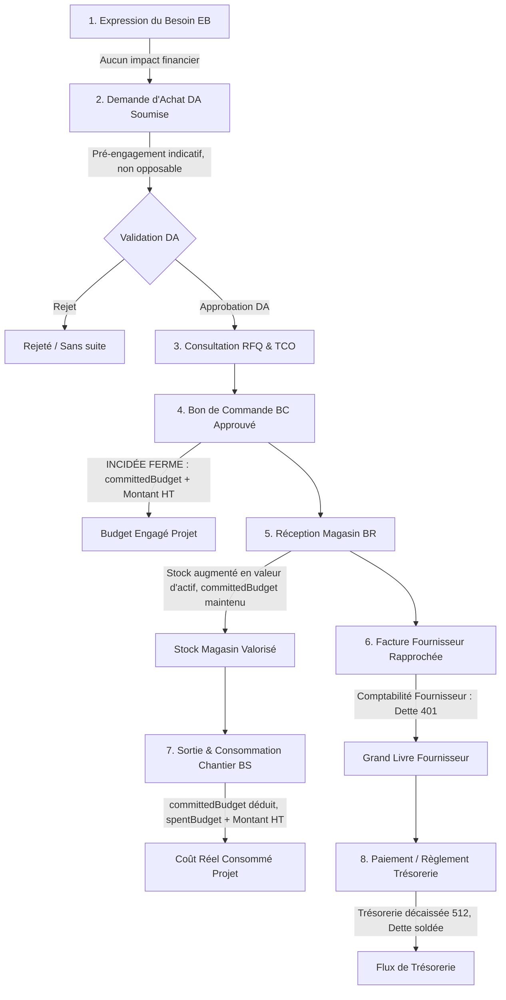

# AUDIT TECHNIQUE & FONCTIONNEL — MODULE 03 : ACHATS, APPROVISIONNEMENT & STOCKS
## ERP SARL SILEX SERVICES — PHASE 4

**Date :** Novembre 2026  
**Auteur :** Équipe d'Architecture & Ingénierie ERP  
**Statut :** Document d'audit initial & cadrage fonctionnel  

---

## 1. CARTOGRAPHIE DE L'EXISTANT

SARL Silex Services utilise historiquement le logiciel **Beinx** pour la gestion de ses achats et stocks. Le prototype ERP existant comporte une base fonctionnelle sur Next.js 15 / NestJS 11 / PostgreSQL Neon, enrichie lors des phases précédentes (notamment lors de la Phase 3 avec l'émission de DA depuis le chantier et la sortie de stock chantier).

Une inspection minutieuse du code a été menée sur :
- **Frontend** :
  - `apps/web/src/app/(dashboard)/procurement/page.tsx` (162 Ko — 3 151 lignes)
  - `apps/web/src/app/(dashboard)/inventory/page.tsx` (134 Ko — 2 730 lignes)
- **API & passerelle** : `apps/web/src/app/api/[...path]/route.ts` (661 lignes)
- **Store & persistance** : `apps/web/src/lib/server-store.ts`, `apps/web/src/lib/db-bridge.ts`
- **Backend NestJS** :
  - `apps/api/src/modules/procurement/` (`procurement.service.ts` 700 lignes, `procurement.controller.ts`)
  - `apps/api/src/modules/inventory/` (`inventory.service.ts` 687 lignes, `inventory.controller.ts`)
- **Schéma Prisma** : `apps/api/prisma/schema.prisma` (modèles `PurchaseRequest`, `PurchaseOrder`, `Supplier`, `GoodsReceipt`, `Item`, `Warehouse`, `StockMovement`, `ProjectMaterialAllocation`)

---

## 2. MATRICE DE DIAGNOSTIC DES 19 FONCTIONNALITÉS (PHASE 1)

| N° | Fonctionnalité | Frontend | Backend | Base de données | Tests | Statut Actuel | Commentaire & Travaux Requis |
| :---: | :--- | :--- | :--- | :--- | :--- | :---: | :--- |
| **1** | **Articles & Catalogue** | `inventory/page.tsx` (onglet Catalogue) | `inventory.service.ts` (`getItems`, `createItem`) | Modèle `Item` | Partiel | **EXISTANT ET FONCTIONNEL** | Gestion articles, catégories, seuils min/actuel opérationnelle. À enrichir : distinction stricte consommables vs équipements vs sous-traitance vs locations. |
| **2** | **Catégories d'articles** | Selects dans création article / DA | Enums & relations | `ItemCategory` | OK | **EXISTANT ET FONCTIONNEL** | Catégories industrielles présentes (Tuyauterie, Soudage, Mécanique, HVAC, EPI). |
| **3** | **Fournisseurs (Registre & Fiche)** | `procurement/page.tsx` (onglet Fournisseurs) | `procurement.service.ts` (`getSuppliers`, `createSupplier`) | Modèle `Supplier` | OK | **EXISTANT MAIS INCOMPLET** | Table présente avec RC/NIF/RIB. Manque : fiche détaillée A4, gestion des statuts (`ACTIF`, `EN_EVALUATION`, `SUSPENDU`, `INACTIF`) et historique complet. |
| **4** | **Expression du besoin (EB)** | Absent comme entité distincte de la DA | Absent | Absent | Non | **À DÉVELOPPER** | Confondu actuellement avec la DA. Doit être formalisé comme étape amont émise par le chef de chantier avant validation achats. |
| **5** | **Demandes d'achat (DA)** | `procurement/page.tsx` (onglet DA) | `procurement.service.ts` (`getPurchaseRequests`, `createPurchaseRequest`) | `PurchaseRequest`, `PurchaseRequestLine` | OK | **EXISTANT ET FONCTIONNEL** | Création multi-lignes, ventilation HT/TVA/TTC, exigences documentaires (CCPU 3.1, CND, CoC, ATEX). |
| **6** | **Approbations & Circuits** | Modales d'arbitrage dans `procurement` & `/workflows` | `procurement.service.ts` (`submitForApproval`, `approvePurchaseRequest`) | `Workflow`, statuts DA | OK | **EXISTANT MAIS INCOMPLET** | Circuit d'approbation présent mais seuils à rendre configurables (pas de seuil codé en dur). |
| **7** | **Demandes de prix (RFQ)** | Modal "Ajouter Devis Fournisseur" | `procurement.service.ts` (`addSupplierQuote`) | `SupplierQuote` | Partiel | **EXISTANT MAIS INCOMPLET** | Permet d'enregistrer des offres mais manque la gestion formelle d'une consultation RFQ multi-fournisseurs avec date limite. |
| **8** | **Offres fournisseurs** | Formulaire modal dans DA | `procurement.service.ts` (`addSupplierQuote`) | `SupplierQuote`, `SupplierQuoteLine` | Partiel | **EXISTANT ET FONCTIONNEL** | Prix, délais, CCPU, TVA et conformité technique enregistrés. |
| **9** | **Comparateur TCO multicritères** | Tableau comparatif dans détail DA | Algorithme pondéré dans `procurement.service.ts` | Calculé dynamiquement | Partiel | **EXISTANT MAIS INCOMPLET** | Matrice présente mais scoring non configurable par l'utilisateur, manque critères éliminatoires formels et fiche A4 TCO officielle. |
| **10** | **Commandes fournisseurs (BC)** | `procurement/page.tsx` (onglet Commandes) | `procurement.service.ts` (`confirmPurchaseOrder`, `getPurchaseOrders`) | `PurchaseOrder`, `PurchaseOrderLine` | OK | **EXISTANT MAIS INCOMPLET** | Génération de BC fonctionnelle. Manque : gestion des révisions, statuts avancés et interconnexion avec les réceptions partielles. |
| **11** | **Contrats fournisseurs** | Absent | Absent | Documents rattachés | Non | **À DÉVELOPPER** | Registre documentaire des contrats cadres et sous-traitance avec dates et alertes d'échéance. |
| **12** | **Réception & Contrôle Qualité** | `inventory/page.tsx` (modal Réception) | `inventory.service.ts` (`receiveGoods`) | `GoodsReceipt`, `GoodsReceiptLine` | Partiel | **EXISTANT MAIS INCOMPLET** | Réception de base présente. Manque : gestion stricte des livraisons partielles successives, quantités refusées/rebuts et non-conformités. |
| **13** | **Entrées en stock** | Automatique lors de la réception | `inventory.service.ts` | `StockMovement` | OK | **EXISTANT ET FONCTIONNEL** | Incrémentation du stock physique lors d'une réception validée. |
| **14** | **Sorties de stock (Bons de sortie)** | `inventory/page.tsx` (onglet Bons de sortie) | `inventory.service.ts` (`issueMaterialToProject`) | `StockMovement`, `ProjectMaterialAllocation` | OK | **EXISTANT ET FONCTIONNEL** | Sortie rattachée au projet avec vérification stricte anti-stock négatif et génération de bon imprimable. |
| **15** | **Transferts multi-magasins** | `inventory/page.tsx` (onglet Transferts) | `inventory.service.ts` (`transferBetweenWarehouses`) | `StockMovement` | OK | **EXISTANT MAIS INCOMPLET** | Transfert magasin à magasin en place. À étendre : transfert chantier vers chantier et suivi du transit. |
| **16** | **Inventaires physiques** | Absent comme workflow structuré (seul adjustStock existe) | `inventory.service.ts` (`adjustStock`) | `StockMovement` | Non | **À DÉVELOPPER** | Absence d'un cycle d'inventaire complet (comptage à l'aveugle, comparaison théorique/physique, calcul d'écarts et validation DG avant régularisation). |
| **17** | **Stocks par chantier** | Filtrage par projet dans `inventory` | `getStockMovements({ projectId })` | `ProjectMaterialAllocation` | Partiel | **EXISTANT ET FONCTIONNEL** | Matériel alloué visible par projet. Manque : gestion de magasins de type "CHANTIER" dédiés. |
| **18** | **Évaluation des fournisseurs** | Note statique dans fiche fournisseur | Absent | Champ `rating` | Non | **À DÉVELOPPER** | Système d'évaluation périodique multicritères (Qualité, Délais, Quantités, SAV, Réactivité) avec historique et notation calculée. |
| **19** | **Dashboard Achats & Stocks** | Bandeaux KPI en tête de pages | Métriques calculées | Agrégations SQL / Store | Partiel | **EXISTANT MAIS INCOMPLET** | KPI présents mais certains calculs méritent consolidation (articles sous seuil, valeur stock au CUMP, commandes en cours). |

---

## 3. VÉRIFICATION CRITIQUE DU CYCLE FINANCIER & DES BUDGETS

### 3.1 Problématique de la double comptabilisation
Dans les ERP industriels mal conçus, un même montant d'achat risque d'être agrégé plusieurs fois :
1. Au moment de la DA (engagement présumé).
2. Au moment du Bon de Commande (engagement contractuel).
3. Au moment de la Réception (dépense constatée).
4. Au moment de la Sortie pour pose sur chantier (consommation analytique).
5. Au moment de la Facture fournisseur (dette fournisseur).
6. Au moment du Paiement (décaissement trésorerie).

Si l'on additionne ces grandeurs, le projet semblerait avoir dépensé 6 fois le montant de la commande !

### 3.2 Règles financières strictes retenues pour SILEX SERVICES

### Règles formelles de gestion budgétaire :
1. **Expression de besoin (EB) & DA en brouillon** : $\Delta(\text{Budget Engagé}) = 0$, $\Delta(\text{Budget Consommé}) = 0$.
2. **DA soumise / en validation** : Information visuelle de pré-engagement, mais le budget contractuel formel n'est pas grevé.
3. **Bon de Commande (BC) approuvé et notifié** :
   $$\text{committedBudget} \leftarrow \text{committedBudget} + \text{Montant HT Commande}$$
4. **Réception de marchandises (BR)** : La marchandise entre dans l'actif circulant de l'entreprise (Compte de stock). L'engagement sur le projet demeure actif jusqu'à affectation.
5. **Sortie réelle de stock pour consommation sur chantier (BS)** :
   $$\text{committedBudget} \leftarrow \max(0, \text{committedBudget} - \text{Montant Consommé})$$
   $$\text{spentBudget} \leftarrow \text{spentBudget} + \text{Montant Consommé}$$
   *Garantie mathématique : Aucun double comptage entre commande engagée et matière posée.*
6. **Facture fournisseur et Paiement** : Appartiennent au cycle de liquidation comptable (dette fournisseur / trésorerie) et n'altèrent pas une seconde fois les dépenses analytiques du chantier.

---

## 4. CONTRÔLE DES DONNÉES DU TEST E2E PHASE 3

Lors de la validation de la Phase 3, le test E2E `scripts/test-project-e2e.js` a interagi avec le chantier `PRJ-2026-001` :
- **Demande d'achat créée** : `DA-2026-001` d'un montant de 640 000 DA HT pour fourniture de coudes et raccords.
- **Mouvement de stock créé** : `SM-2026-XXXX` sortant 10 ml de tubes acier carbone (valeur 200 000 DA) affectés au site de Skikda RA1K.
- **Budget constaté** :
  - Budget alloué : 36 800 000 DA
  - Budget engagé : 23 040 000 DA (22 400 000 DA initial + 640 000 DA DA)
  - Budget consommé : 14 426 000 DA (14 226 000 DA initial + 200 000 DA sortie matière)

### Isolation & Non-Pollution :
- La base Neon PostgreSQL n'a subi aucune altération de schéma destructrice ni réinitialisation.
- Le test de la Phase 4 utilisera des identifiants démonstratifs étanches (`PRJ-DEMO-001` ou suffixe contrôlé) pour exécuter le cycle complet sans corrompre les données historiques du chantier de Skikda.

---

## 5. PLAN D'IMPLÉMENTATION DE LA PHASE 4

Pour couvrir 100% des exigences du Master Prompt Phase 4, les travaux prioritaires suivants sont engagés :

1. **Expressions de Besoin (EB)** : Création de l'entité et du workflow `EB` (Chantier -> Validation Resp. Projet -> Transmission Achats pour conversion en DA).
2. **Consultations Fournisseurs (RFQ) & Offres** : Enregistrement formel des consultations, invitations de fournisseurs et comparaison des variantes d'offres.
3. **Comparateur TCO Multicritères Paramétrable** :
   - Moteur de scoring avec pondérations configurables (Coût 35%, Technique 25%, Délais 20%, Qualité 10%, Garantie 10%).
   - Critères éliminatoires stricts (conformité CCPU 3.1 / ASME).
   - Matrice visuelle comparative et fiche A4 officielle imprimable.
4. **Bons de Commande & Contrats Fournisseurs** : Cycle complet de commande avec révisions et suivi des contrats de sous-traitance.
5. **Réceptions Partielles & Contrôle Qualité** : Suivi des reliquats de livraison, motifs de rejet, non-conformités et mise à jour automatique des stocks.
6. **Magasins Multi-Sites & Stocks Chantiers** : Distinction Magasin Central Arzew, Dépôt Skikda, Stocks temporaires et transferts inter-sites.
7. **Processus d'Inventaire Physique** : Module d'inventaire complet avec comptage physique, calcul automatique des écarts et régularisation autorisée par la DG.
8. **Évaluation Fournisseurs** : Module d'évaluation périodique multicritères avec notation et tableau de classement.
9. **Dashboard Achats & Stocks Consolidé** : Indicateurs en temps réel calculés sans mockdata.
10. **Suite de Tests E2E Automatisés (`scripts/test-procurement-e2e.js`)** : Validation du cycle nominal en 20 étapes et tests métier négatifs.
