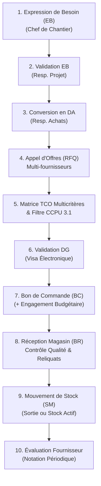

# SILEX ERP — Matrice des Workflows du Module 03 (Achats & Stocks)

**Version :** 1.0.0 (Phase 4)  
**Date :** Novembre 2026  
**Société :** SARL SILEX SERVICES  

---

## 1. Vue d'Ensemble du Macro-Workflow

Le cycle complet s'articule autour de 8 étapes séquentielles strictement auditables :

---

## 2. Détail des Workflows Métier

### Workflow 1 : De l'Expression de Besoin (EB) à la Demande d'Achat (DA)

1. **Déclencheur** : Un besoin matière ou outillage survient sur un chantier (ex: tubes haute pression Sch 40 DN150 pour l'arrêt d'unité à Skikda RA1K).
2. **Émetteur** : Chef de Chantier ou Chef d'Équipe Tuyauterie via l'écran *Procurement / Need Requests*.
3. **Statut Initial** : `SOUMISE`.
4. **Validation Opérationnelle** : Le Responsable de Projet vérifie :
   - L'adéquation avec les spécifications techniques du contrat client.
   - La cohérence du calendrier par rapport au planning d'avancement.
   - Statut après validation : `VALIDEE`.
5. **Prise en charge Achats** : Le Responsable Achats convertit l'EB validée en Demande d'Achat officielle (`DA-YYYY-NNNN`).
   - Statut EB final : `CONVERTIE_EN_DA`.
   - Traçabilité : La DA porte la référence de l'EB source.

---

### Workflow 2 : Consultation Fournisseurs (RFQ) & Comparateur TCO

1. **Déclencheur** : DA approuvée nécessitant une mise en concurrence (montant > seuil de consultation ou fourniture critique).
2. **Création RFQ** : L'Acheteur définit :
   - Date limite de réception des offres.
   - Lieu de livraison convenu.
   - Critère éliminatoire obligatoire : `mandatoryCcpuRequired = true` (exigence certificat matière EN 10204 3.1).
   - Pénalités de retard journalières.
   - Fournisseurs homologués invités.
3. **Réception des Plis** :
   - Saisie des offres reçues avec prix HT, délais, conditions de règlement, durée de garantie et documents qualité transmis.
4. **Calcul Automatique TCO** :
   - Le système filtre automatiquement les offres : si un fournisseur ne fournit pas le CCPU 3.1 obligatoire, son offre est marquée `isEliminated = true` avec un score global de `0/100`.
   - Pour les offres conformes, application des formules de normalisation directionnelle (Min/Max).
   - Détermination du score global pondéré et recommandation du fournisseur classé au **Rang 1**.
5. **Arbitrage Direction Générale** :
   - Si le montant total dépasse 500 000 DA, la Direction Générale consulte la fiche TCO comparative et appose son visa électronique (`VISA-DG-TCO-...`).
   - Statut TCO : `APPROUVE_DG`.

---

### Workflow 3 : Émission du Bon de Commande (BC) & Impact Budgétaire

1. **Génération BC** : Depuis le comparatif TCO approuvé par la DG, le système génère le Bon de Commande officiel (`BC-YYYY-NNNN`) avec :
   - Informations complètes du fournisseur retenu.
   - Lignes de commandes avec quantités, prix unitaires, reliquats initiaux.
   - Statut : `CONFIRMED`.
2. **Impact Budgétaire Immédiat** :
   - Le projet rattaché voit son `committedBudget` augmenter immédiatement du montant HT de la commande.
   - Le `spentBudget` reste rigoureusement inchangé (aucune facture ni sortie constatée).

---

### Workflow 4 : Réceptions Partielles (BR), Reliquats & Contrôle Qualité

1. **Arrivée Transporteur au Magasin / Chantier** :
   - Le Magasinier contrôle le Bon de Livraison (BL) papier et les plaques du camion.
2. **Contrôle Qualité Réception** :
   - Examen dimensionnel, visuel et vérification de la concordance du numéro de coulée avec le certificat CCPU 3.1.
   - Saisie de la quantité livrée (`deliveredQuantity`).
   - Saisie des pièces non-conformes (`rejectedQuantity`) avec motif précis (ex: ovalisation hors tolérance API 5L).
   - Quantité acceptée : `acceptedQuantity = deliveredQuantity - rejectedQuantity`.
3. **Mise à Jour de la Commande (BC)** :
   - `receivedQuantity = previouslyReceived + acceptedQuantity`.
   - `remainingQuantity = orderedQuantity - receivedQuantity`.
   - Si `remainingQuantity > 0` : le BC passe au statut `PARTIALLY_RECEIVED`.
   - Si `remainingQuantity === 0` : le BC passe au statut `RECEIVED` (soldé).
4. **Mise à Jour des Stocks** :
   - Seule la quantité acceptée entre dans le stock disponible du magasin (`currentStock`).
   - Les pièces rejetées sont tracées sur le BR mais isolées physiquement en zone de quarantaine.
   - Génération d'un mouvement de stock traçable de type `PURCHASE_RECEIPT`.

---

### Workflow 5 : Inventaire Physique, Détection d'Écarts & Régularisation DG

1. **Lancement Session** :
   - Le Responsable Dépôt crée une session d'inventaire (`INV-YYYY-NNN`) ciblée sur un magasin physique.
   - Le statut passe à `EN_COMPTAGE`. Le système fige les stocks théoriques.
2. **Saisie des Comptages Physiques** :
   - L'équipe de comptage saisit les quantités réelles dénombrées sur le terrain.
   - Le système calcule instantanément pour chaque article :
     $$\text{discrepancyQuantity} = \text{physicalCount} - \text{theoreticalStock}$$
     $$\text{discrepancyValueDA} = \text{discrepancyQuantity} \times \text{unitCostDA}$$
   - L'opérateur saisit le motif de l'écart (casse, avarie humidité, erreur de comptage antérieure).
3. **Soumission à la Direction Générale** :
   - Statut de la session : `EN_VALIDATION_DG`.
4. **Validation & Arbitrage DG** :
   - La DG examine les écarts consolidés en valeur (DA).
   - Lors de la validation DG, le système :
     - Passe la session à `CLOTURE`.
     - Met à jour le `currentStock` de chaque article pour l'aligner rigoureusement sur le comptage physique.
     - Génère automatiquement des mouvements de stock officiels `INVENTORY_ADJUSTMENT` (`MVT-AJUST-INV-...`) inscrits dans le grand livre des stocks.
