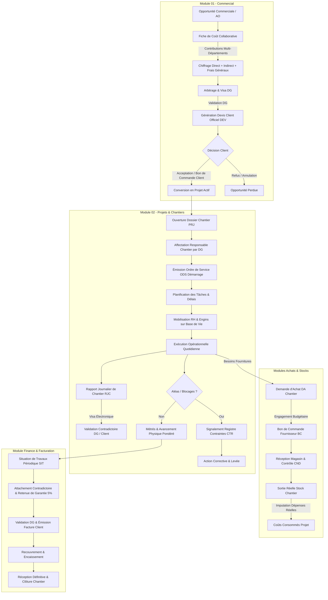

# WORKFLOWS OPÉRATIONNELS & CIRCUITS DE DÉCISION
## ERP SARL SILEX SERVICES — PROCESSUS INDUSTRIEL COMPLET

---

## 1. WORKFLOW COMMERCIAL VERS CHANTIER

1. **Création de l'Opportunité** : Enregistrement du client, secteur d'activité, site d'intervention, date limite de réponse.
2. **Fiche de Coût Collaborative (FC)** :
   - *Département Projets* : Définition des phases, cadences, effectifs et moyens lourds.
   - *Département Achats* : Consultation des fournisseurs pour tuyauterie, raccords, vannes, gaz, tirs radio.
   - *Département RH* : Habilitations, salaires chantiers, base de vie, transport, restauration.
   - *Département Finance* : Paramétrage du taux de marque/marge sur coût, frais généraux et calcul du prix de revient.
3. **Arbitrage Direction Générale** : Contrôle des marges et visa interne de traçabilité.
4. **Émission du Devis Client** : Envoi de l'offre technique et financière au format officiel Silex.
5. **Acceptation Client & Bon de Commande** : Règle stricte : aucun chantier n'est ouvert sans référence formelle du bon de commande ou marché signé du maître d'ouvrage.
6. **Conversion en Projet** : Création idempotente du projet `PRJ-XXXX-XXX`, transfert du budget alloué et des lots contractuels.

---

## 2. WORKFLOW D'EXÉCUTION DU CHANTIER

1. **Notification & Nomination du Responsable** : La DG désigne formellement le conducteur de travaux responsable.
2. **Ordre de Service (ODS)** :
   - ODS de Démarrage fixant la date contractuelle d'ouverture.
   - ODS d'Arrêt en cas de consignation générale ou intempéries (décalant le délai sans pénalité).
   - ODS de Reprise après levée de consignation.
   - ODS d'Avenant pour travaux supplémentaires.
3. **Cycle Quotidien — Rapport Journalier de Chantier (RJC)** :
   - Chaque soir, le conducteur de travaux saisit le rapport journalier.
   - Effectifs présents par corps d'état et heures travaillées.
   - Métrés réels contradictoires réalisés dans la journée.
   - Heures de marche des engins et fournitures consommées.
   - Événements de sécurité (toolbox meeting, presque-accidents).
   - Visa électronique et impression de la fiche A4 légale.
4. **Cycle Hebdomadaire / Quinzaine — Situation de Travaux** :
   - Cumul des métrés contradictoires.
   - Déduction de la retenue de garantie légale (5%).
   - Application de la TVA (19%).
   - Validation DG et transmission à la comptabilité pour émission de la facture de situation.
